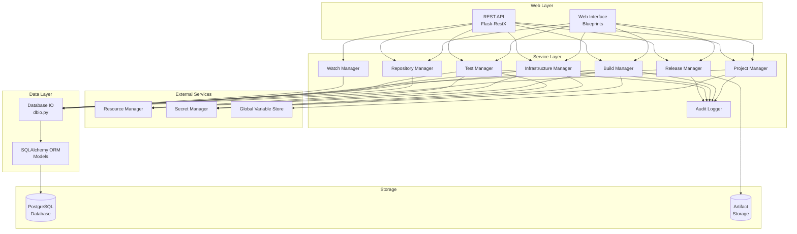
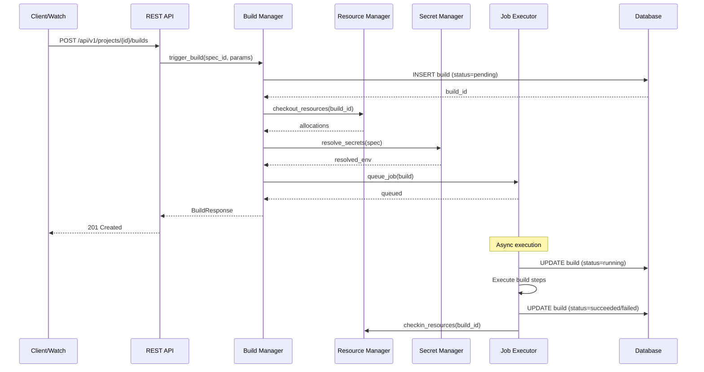
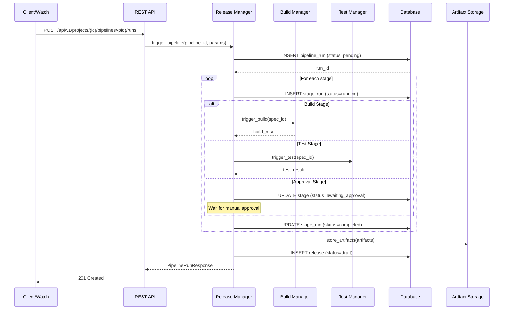
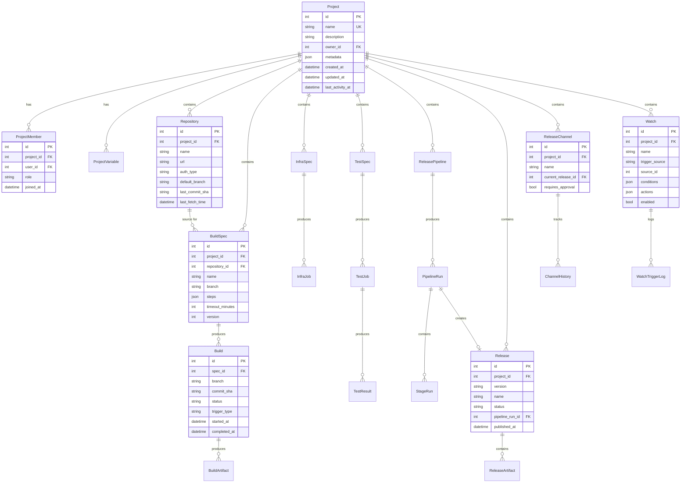

# Design Document: Projects

## Overview

The Projects module provides capabilities for organizing and managing orchestration work within the Pychestrate system. A Project serves as a container that groups related resources, repositories, build specifications, infrastructure specifications, test specifications, releases, and their associated jobs. This design follows the existing Flask/Flask-RestX patterns in the codebase, using SQLAlchemy for data persistence and the established dbio pattern for database operations.

The module consists of the following primary components:
1. **Project Manager** - Handles project CRUD, membership, and access control
2. **Repository Manager** - Handles repository associations and connectivity
3. **Build Manager** - Handles build specifications and build execution
4. **Infrastructure Manager** - Handles infrastructure specifications and jobs
5. **Test Manager** - Handles test specifications and test job execution
6. **Release Manager** - Handles releases, release pipelines, and artifacts
7. **Watch Manager** - Handles repository and build watches for automation

## Existing Implementation

The following components from existing modules will be leveraged:

### Core Package (`source/packages/automojo/pychestrate/core/`)
- **orm.py**: Contains base models, User, Role, Permission models
- **managers/**: UserManager, SecurityManager, AuditLogger, ResourceManager
- **dbconnection.py**: PostgreSQL connection factory
- **dbio.py**: Database helper functions

### Web Service (`source/site/automojo/pychestrate/webservice/`)
- **restapi/versions/v1/config/**: REST API patterns and authentication decorators
- **restapi/versions/v1/resources/**: Resource management API patterns
- **webinterface/blueprints/**: Web interface patterns with Vue.js/Bootstrap


## Architecture



### Build Execution Flow




### Release Pipeline Flow



## Components and Interfaces

### Project Manager

The Project Manager handles project definitions, membership, and access control.

```python
from typing import Optional, List, Dict, Any
from dataclasses import dataclass, field
from datetime import datetime
from enum import Enum

class ProjectRole(Enum):
    OWNER = "owner"
    ADMINISTRATOR = "administrator"
    DEVELOPER = "developer"
    VIEWER = "viewer"

@dataclass
class ProjectCreateRequest:
    name: str
    description: str = ""
    metadata: Dict[str, Any] = field(default_factory=dict)

@dataclass
class ProjectUpdateRequest:
    name: Optional[str] = None
    description: Optional[str] = None
    metadata: Optional[Dict[str, Any]] = None

@dataclass
class ProjectResponse:
    id: int
    name: str
    description: str
    owner_id: int
    owner_username: str
    metadata: Dict[str, Any]
    created_at: datetime
    updated_at: datetime
    last_activity_at: datetime
    member_count: int
    repository_count: int
    active_jobs: int

@dataclass
class ProjectMemberResponse:
    user_id: int
    username: str
    display_name: str
    role: ProjectRole
    joined_at: datetime

@dataclass
class ProjectVariableCreateRequest:
    name: str
    value: Any
    var_type: str  # string, integer, float, boolean, json
    is_sensitive: bool = False
    description: str = ""

@dataclass
class ProjectVariableResponse:
    id: int
    name: str
    value: Any  # Masked if sensitive
    var_type: str
    is_sensitive: bool
    description: str
    created_at: datetime
    updated_at: datetime


class ProjectManager:
    def create_project(self, request: ProjectCreateRequest, 
                       user_id: int) -> ProjectResponse:
        """Create a new project with the user as owner."""
        pass
    
    def get_project(self, project_id: int) -> Optional[ProjectResponse]:
        """Get a project by ID."""
        pass
    
    def get_project_by_name(self, name: str) -> Optional[ProjectResponse]:
        """Get a project by name."""
        pass
    
    def update_project(self, project_id: int, request: ProjectUpdateRequest,
                       user_id: int) -> ProjectResponse:
        """Update project information."""
        pass
    
    def delete_project(self, project_id: int, user_id: int) -> None:
        """Delete a project. Fails if active jobs exist."""
        pass
    
    def list_projects(self, user_id: int, offset: int = 0, limit: int = 50,
                      search: str = None) -> List[ProjectResponse]:
        """List projects the user has access to."""
        pass
    
    def validate_project_name(self, name: str) -> bool:
        """Validate project name format."""
        pass
    
    # Membership Management
    def add_member(self, project_id: int, user_id: int, role: ProjectRole,
                   added_by: int) -> ProjectMemberResponse:
        """Add a user to a project with specified role."""
        pass
    
    def remove_member(self, project_id: int, user_id: int, 
                      removed_by: int) -> None:
        """Remove a user from a project."""
        pass
    
    def update_member_role(self, project_id: int, user_id: int, 
                           role: ProjectRole, updated_by: int) -> ProjectMemberResponse:
        """Update a member's role in the project."""
        pass
    
    def list_members(self, project_id: int, offset: int = 0,
                     limit: int = 50) -> List[ProjectMemberResponse]:
        """List project members."""
        pass
    
    def check_permission(self, project_id: int, user_id: int, 
                         permission: str) -> bool:
        """Check if user has permission on project."""
        pass
    
    # Resource Assignment
    def assign_resource(self, project_id: int, resource_id: int,
                        user_id: int) -> None:
        """Assign a resource to the project."""
        pass
    
    def unassign_resource(self, project_id: int, resource_id: int,
                          user_id: int) -> None:
        """Remove resource assignment from project."""
        pass
    
    def list_assigned_resources(self, project_id: int, offset: int = 0,
                                limit: int = 50) -> List[dict]:
        """List resources assigned to project."""
        pass
    
    def is_resource_assigned(self, project_id: int, resource_id: int) -> bool:
        """Check if resource is assigned to project."""
        pass
    
    # Project Variables
    def create_variable(self, project_id: int, request: ProjectVariableCreateRequest,
                        user_id: int) -> ProjectVariableResponse:
        """Create a project variable."""
        pass
    
    def update_variable(self, project_id: int, variable_id: int, 
                        value: Any, user_id: int) -> ProjectVariableResponse:
        """Update a project variable value."""
        pass
    
    def delete_variable(self, project_id: int, variable_id: int,
                        user_id: int) -> None:
        """Delete a project variable."""
        pass
    
    def list_variables(self, project_id: int, include_sensitive: bool = False,
                       offset: int = 0, limit: int = 50) -> List[ProjectVariableResponse]:
        """List project variables."""
        pass
    
    def resolve_variable(self, project_id: int, name: str) -> Any:
        """Resolve variable value, checking project then global scope."""
        pass
```


### Repository Manager

The Repository Manager handles repository associations and connectivity.

```python
from typing import Optional, List
from dataclasses import dataclass, field
from datetime import datetime
from enum import Enum

class RepositoryAuthType(Enum):
    HTTPS_TOKEN = "https_token"
    SSH_KEY = "ssh_key"
    NONE = "none"

@dataclass
class RepositoryCreateRequest:
    name: str
    url: str
    auth_type: RepositoryAuthType
    credential_secret_ref: Optional[str] = None  # Reference to secret
    default_branch: str = "main"
    description: str = ""

@dataclass
class RepositoryUpdateRequest:
    name: Optional[str] = None
    credential_secret_ref: Optional[str] = None
    default_branch: Optional[str] = None
    description: Optional[str] = None

@dataclass
class RepositoryResponse:
    id: int
    project_id: int
    name: str
    url: str
    auth_type: RepositoryAuthType
    default_branch: str
    description: str
    last_commit_sha: Optional[str]
    last_commit_message: Optional[str]
    last_commit_author: Optional[str]
    last_commit_time: Optional[datetime]
    last_fetch_time: Optional[datetime]
    created_at: datetime

@dataclass
class BranchResponse:
    name: str
    commit_sha: str
    commit_message: str
    commit_author: str
    commit_time: datetime

class RepositoryManager:
    def add_repository(self, project_id: int, request: RepositoryCreateRequest,
                       user_id: int) -> RepositoryResponse:
        """Add a repository to a project."""
        pass
    
    def get_repository(self, repository_id: int) -> Optional[RepositoryResponse]:
        """Get repository by ID."""
        pass
    
    def update_repository(self, repository_id: int, request: RepositoryUpdateRequest,
                          user_id: int) -> RepositoryResponse:
        """Update repository configuration."""
        pass
    
    def remove_repository(self, repository_id: int, user_id: int) -> None:
        """Remove repository from project."""
        pass
    
    def list_repositories(self, project_id: int, offset: int = 0,
                          limit: int = 50) -> List[RepositoryResponse]:
        """List repositories in a project."""
        pass
    
    def test_connectivity(self, repository_id: int) -> bool:
        """Test repository connectivity."""
        pass
    
    def fetch_latest(self, repository_id: int) -> RepositoryResponse:
        """Fetch latest commit information."""
        pass
    
    def list_branches(self, repository_id: int) -> List[BranchResponse]:
        """List branches in repository."""
        pass
    
    def get_commit_info(self, repository_id: int, ref: str) -> dict:
        """Get commit information for a ref (branch, tag, sha)."""
        pass
```


### Build Manager

The Build Manager handles build specifications and build execution.

```python
from typing import Optional, List, Dict, Any
from dataclasses import dataclass, field
from datetime import datetime
from enum import Enum

class BuildTriggerType(Enum):
    MANUAL = "manual"
    WEBHOOK = "webhook"
    SCHEDULE = "schedule"
    WATCH = "watch"
    API = "api"

class JobStatus(Enum):
    PENDING = "pending"
    QUEUED = "queued"
    RUNNING = "running"
    SUCCEEDED = "succeeded"
    FAILED = "failed"
    CANCELLED = "cancelled"

@dataclass
class BuildStepDefinition:
    name: str
    type: str  # checkout, script, artifact, notification
    config: Dict[str, Any]
    continue_on_failure: bool = False

@dataclass
class BuildSpecCreateRequest:
    name: str
    repository_id: int
    branch: str = "main"
    steps: List[BuildStepDefinition] = field(default_factory=list)
    environment: Dict[str, str] = field(default_factory=dict)
    timeout_minutes: int = 60
    description: str = ""

@dataclass
class BuildSpecResponse:
    id: int
    project_id: int
    name: str
    repository_id: int
    repository_name: str
    branch: str
    steps: List[BuildStepDefinition]
    environment: Dict[str, str]
    timeout_minutes: int
    description: str
    version: int
    created_at: datetime
    updated_at: datetime

@dataclass
class BuildTriggerRequest:
    spec_id: int
    branch: Optional[str] = None  # Override spec branch
    commit_sha: Optional[str] = None  # Specific commit
    parameters: Dict[str, Any] = field(default_factory=dict)
    trigger_type: BuildTriggerType = BuildTriggerType.MANUAL

@dataclass
class BuildResponse:
    id: int
    project_id: int
    spec_id: int
    spec_name: str
    spec_version: int
    repository_name: str
    branch: str
    commit_sha: str
    commit_message: str
    status: JobStatus
    trigger_type: BuildTriggerType
    triggered_by_id: int
    triggered_by_username: str
    started_at: Optional[datetime]
    completed_at: Optional[datetime]
    duration_seconds: Optional[int]
    artifact_count: int
    created_at: datetime

@dataclass
class BuildArtifactResponse:
    id: int
    build_id: int
    name: str
    path: str
    size_bytes: int
    checksum: str
    created_at: datetime


class BuildManager:
    def create_spec(self, project_id: int, request: BuildSpecCreateRequest,
                    user_id: int) -> BuildSpecResponse:
        """Create a build specification."""
        pass
    
    def get_spec(self, spec_id: int) -> Optional[BuildSpecResponse]:
        """Get build specification by ID."""
        pass
    
    def update_spec(self, spec_id: int, request: BuildSpecCreateRequest,
                    user_id: int) -> BuildSpecResponse:
        """Update build specification (creates new version)."""
        pass
    
    def delete_spec(self, spec_id: int, user_id: int) -> None:
        """Delete build specification. Fails if active builds exist."""
        pass
    
    def list_specs(self, project_id: int, offset: int = 0,
                   limit: int = 50) -> List[BuildSpecResponse]:
        """List build specifications in a project."""
        pass
    
    def validate_spec(self, spec: BuildSpecCreateRequest) -> List[str]:
        """Validate build specification syntax. Returns list of errors."""
        pass
    
    # Build Execution
    def trigger_build(self, request: BuildTriggerRequest,
                      user_id: int) -> BuildResponse:
        """Trigger a new build."""
        pass
    
    def get_build(self, build_id: int) -> Optional[BuildResponse]:
        """Get build by ID."""
        pass
    
    def cancel_build(self, build_id: int, user_id: int) -> BuildResponse:
        """Cancel a pending or running build."""
        pass
    
    def list_builds(self, project_id: int = None, spec_id: int = None,
                    status: JobStatus = None, offset: int = 0,
                    limit: int = 50) -> List[BuildResponse]:
        """List builds with filtering."""
        pass
    
    def get_build_logs(self, build_id: int, step_name: str = None) -> str:
        """Get build execution logs."""
        pass
    
    def stream_build_logs(self, build_id: int):
        """Stream build logs for running builds."""
        pass
    
    # Artifacts
    def list_artifacts(self, build_id: int) -> List[BuildArtifactResponse]:
        """List artifacts produced by a build."""
        pass
    
    def get_artifact(self, artifact_id: int) -> Optional[BuildArtifactResponse]:
        """Get artifact metadata."""
        pass
    
    def download_artifact(self, artifact_id: int) -> bytes:
        """Download artifact content."""
        pass
    
    # Cleanup
    def cleanup_old_builds(self, project_id: int, retention_days: int) -> int:
        """Remove builds older than retention period. Returns count removed."""
        pass
```


### Infrastructure Manager

The Infrastructure Manager handles infrastructure specifications and jobs.

```python
from typing import Optional, List, Dict, Any
from dataclasses import dataclass, field
from datetime import datetime
from enum import Enum

class InfraProvider(Enum):
    LOCAL = "local"
    DOCKER = "docker"
    KUBERNETES = "kubernetes"
    AWS = "aws"
    AZURE = "azure"
    GCP = "gcp"

class InfraAction(Enum):
    PROVISION = "provision"
    UPDATE = "update"
    DESTROY = "destroy"

class InfraState(Enum):
    PENDING = "pending"
    PROVISIONING = "provisioning"
    RUNNING = "running"
    UPDATING = "updating"
    DESTROYING = "destroying"
    DESTROYED = "destroyed"
    FAILED = "failed"

@dataclass
class InfraResourceDefinition:
    name: str
    type: str  # vm, container, network, storage, etc.
    provider_config: Dict[str, Any]

@dataclass
class InfraSpecCreateRequest:
    name: str
    provider: InfraProvider
    resources: List[InfraResourceDefinition] = field(default_factory=list)
    variables: Dict[str, Any] = field(default_factory=dict)
    timeout_minutes: int = 30
    description: str = ""

@dataclass
class InfraSpecResponse:
    id: int
    project_id: int
    name: str
    provider: InfraProvider
    resources: List[InfraResourceDefinition]
    variables: Dict[str, Any]
    timeout_minutes: int
    description: str
    version: int
    created_at: datetime
    updated_at: datetime

@dataclass
class InfraJobTriggerRequest:
    spec_id: int
    action: InfraAction
    variables: Dict[str, Any] = field(default_factory=dict)

@dataclass
class InfraJobResponse:
    id: int
    project_id: int
    spec_id: int
    spec_name: str
    spec_version: int
    action: InfraAction
    state: InfraState
    status: JobStatus
    triggered_by_id: int
    triggered_by_username: str
    provisioned_resources: List[Dict[str, Any]]
    connection_details: Dict[str, Any]
    started_at: Optional[datetime]
    completed_at: Optional[datetime]
    duration_seconds: Optional[int]
    created_at: datetime


class InfrastructureManager:
    def create_spec(self, project_id: int, request: InfraSpecCreateRequest,
                    user_id: int) -> InfraSpecResponse:
        """Create an infrastructure specification."""
        pass
    
    def get_spec(self, spec_id: int) -> Optional[InfraSpecResponse]:
        """Get infrastructure specification by ID."""
        pass
    
    def update_spec(self, spec_id: int, request: InfraSpecCreateRequest,
                    user_id: int) -> InfraSpecResponse:
        """Update infrastructure specification (creates new version)."""
        pass
    
    def delete_spec(self, spec_id: int, user_id: int) -> None:
        """Delete infrastructure specification. Fails if active jobs exist."""
        pass
    
    def list_specs(self, project_id: int, offset: int = 0,
                   limit: int = 50) -> List[InfraSpecResponse]:
        """List infrastructure specifications in a project."""
        pass
    
    def validate_spec(self, spec: InfraSpecCreateRequest) -> List[str]:
        """Validate infrastructure specification syntax. Returns list of errors."""
        pass
    
    # Job Execution
    def trigger_job(self, request: InfraJobTriggerRequest,
                    user_id: int) -> InfraJobResponse:
        """Trigger an infrastructure job."""
        pass
    
    def get_job(self, job_id: int) -> Optional[InfraJobResponse]:
        """Get infrastructure job by ID."""
        pass
    
    def cancel_job(self, job_id: int, user_id: int) -> InfraJobResponse:
        """Cancel a pending or running job."""
        pass
    
    def list_jobs(self, project_id: int = None, spec_id: int = None,
                  state: InfraState = None, status: JobStatus = None,
                  offset: int = 0, limit: int = 50) -> List[InfraJobResponse]:
        """List infrastructure jobs with filtering."""
        pass
    
    def get_job_logs(self, job_id: int) -> str:
        """Get job execution logs."""
        pass
    
    def get_provisioned_resources(self, job_id: int) -> List[Dict[str, Any]]:
        """Get details of provisioned resources."""
        pass
    
    def get_connection_details(self, job_id: int) -> Dict[str, Any]:
        """Get connection details for provisioned infrastructure."""
        pass
```


### Test Manager

The Test Manager handles test specifications and test job execution.

```python
from typing import Optional, List, Dict, Any
from dataclasses import dataclass, field
from datetime import datetime
from enum import Enum

class TestFramework(Enum):
    PYTEST = "pytest"
    UNITTEST = "unittest"
    TESTBASE = "testbase"
    CUSTOM = "custom"

class TestResultFormat(Enum):
    JUNIT_XML = "junit_xml"
    TAP = "tap"
    JSON = "json"

@dataclass
class TestSpecCreateRequest:
    name: str
    framework: TestFramework
    test_command: str
    test_selection: str = ""  # Test filter/pattern
    build_ref: Optional[int] = None  # Reference to build spec
    infra_ref: Optional[int] = None  # Reference to infra spec
    environment: Dict[str, str] = field(default_factory=dict)
    timeout_minutes: int = 60
    result_format: TestResultFormat = TestResultFormat.JUNIT_XML
    description: str = ""

@dataclass
class TestSpecResponse:
    id: int
    project_id: int
    name: str
    framework: TestFramework
    test_command: str
    test_selection: str
    build_ref: Optional[int]
    infra_ref: Optional[int]
    environment: Dict[str, str]
    timeout_minutes: int
    result_format: TestResultFormat
    description: str
    version: int
    created_at: datetime
    updated_at: datetime

@dataclass
class TestJobTriggerRequest:
    spec_id: int
    build_id: Optional[int] = None  # Specific build to test
    infra_job_id: Optional[int] = None  # Specific infrastructure
    parameters: Dict[str, Any] = field(default_factory=dict)

@dataclass
class TestResultSummary:
    total: int
    passed: int
    failed: int
    skipped: int
    errors: int
    duration_seconds: float

@dataclass
class TestJobResponse:
    id: int
    project_id: int
    spec_id: int
    spec_name: str
    spec_version: int
    build_id: Optional[int]
    infra_job_id: Optional[int]
    status: JobStatus
    triggered_by_id: int
    triggered_by_username: str
    result_summary: Optional[TestResultSummary]
    started_at: Optional[datetime]
    completed_at: Optional[datetime]
    duration_seconds: Optional[int]
    created_at: datetime

@dataclass
class TestCaseResult:
    name: str
    classname: str
    status: str  # passed, failed, skipped, error
    duration_seconds: float
    failure_message: Optional[str]
    failure_trace: Optional[str]


class TestManager:
    def create_spec(self, project_id: int, request: TestSpecCreateRequest,
                    user_id: int) -> TestSpecResponse:
        """Create a test specification."""
        pass
    
    def get_spec(self, spec_id: int) -> Optional[TestSpecResponse]:
        """Get test specification by ID."""
        pass
    
    def update_spec(self, spec_id: int, request: TestSpecCreateRequest,
                    user_id: int) -> TestSpecResponse:
        """Update test specification (creates new version)."""
        pass
    
    def delete_spec(self, spec_id: int, user_id: int) -> None:
        """Delete test specification. Fails if active jobs exist."""
        pass
    
    def list_specs(self, project_id: int, offset: int = 0,
                   limit: int = 50) -> List[TestSpecResponse]:
        """List test specifications in a project."""
        pass
    
    def validate_spec(self, spec: TestSpecCreateRequest) -> List[str]:
        """Validate test specification syntax. Returns list of errors."""
        pass
    
    # Job Execution
    def trigger_job(self, request: TestJobTriggerRequest,
                    user_id: int) -> TestJobResponse:
        """Trigger a test job."""
        pass
    
    def get_job(self, job_id: int) -> Optional[TestJobResponse]:
        """Get test job by ID."""
        pass
    
    def cancel_job(self, job_id: int, user_id: int) -> TestJobResponse:
        """Cancel a pending or running job."""
        pass
    
    def list_jobs(self, project_id: int = None, spec_id: int = None,
                  status: JobStatus = None, offset: int = 0,
                  limit: int = 50) -> List[TestJobResponse]:
        """List test jobs with filtering."""
        pass
    
    def get_job_logs(self, job_id: int) -> str:
        """Get job execution logs."""
        pass
    
    # Results
    def get_test_results(self, job_id: int) -> List[TestCaseResult]:
        """Get detailed test case results."""
        pass
    
    def get_result_summary(self, job_id: int) -> TestResultSummary:
        """Get test result summary."""
        pass
    
    # Metrics
    def get_test_metrics(self, project_id: int, spec_id: int = None,
                         days: int = 30) -> Dict[str, Any]:
        """Get test metrics (pass rate, duration trends, flaky tests)."""
        pass
    
    def get_flaky_tests(self, project_id: int, threshold: float = 0.1,
                        days: int = 30) -> List[Dict[str, Any]]:
        """Identify flaky tests based on inconsistent results."""
        pass
```


### Release Manager

The Release Manager handles releases, release pipelines, and artifacts.

```python
from typing import Optional, List, Dict, Any
from dataclasses import dataclass, field
from datetime import datetime
from enum import Enum

class ReleaseStatus(Enum):
    DRAFT = "draft"
    PENDING_APPROVAL = "pending_approval"
    APPROVED = "approved"
    PUBLISHED = "published"
    DEPRECATED = "deprecated"
    RECALLED = "recalled"

class PipelineStageType(Enum):
    CHECKOUT = "checkout"
    BUILD = "build"
    TEST = "test"
    PACKAGE = "package"
    SIGN = "sign"
    PUBLISH = "publish"
    NOTIFY = "notify"
    APPROVAL = "approval"

class PipelineTriggerType(Enum):
    MANUAL = "manual"
    TAG_PUSH = "tag_push"
    BRANCH_MERGE = "branch_merge"
    SCHEDULE = "schedule"
    API = "api"

class ArtifactType(Enum):
    BINARY = "binary"
    ARCHIVE = "archive"
    CONTAINER_IMAGE = "container_image"
    PACKAGE = "package"
    DOCUMENTATION = "documentation"
    CUSTOM = "custom"

@dataclass
class PipelineStageDefinition:
    name: str
    type: PipelineStageType
    config: Dict[str, Any]
    requires_approval: bool = False
    continue_on_failure: bool = False

@dataclass
class ReleasePipelineCreateRequest:
    name: str
    stages: List[PipelineStageDefinition]
    triggers: List[PipelineTriggerType] = field(default_factory=list)
    variables: Dict[str, Any] = field(default_factory=dict)
    description: str = ""

@dataclass
class ReleasePipelineResponse:
    id: int
    project_id: int
    name: str
    stages: List[PipelineStageDefinition]
    triggers: List[PipelineTriggerType]
    variables: Dict[str, Any]
    description: str
    version: int
    created_at: datetime
    updated_at: datetime

@dataclass
class PipelineRunResponse:
    id: int
    pipeline_id: int
    pipeline_name: str
    pipeline_version: int
    status: JobStatus
    current_stage: Optional[str]
    triggered_by_id: int
    triggered_by_username: str
    trigger_type: PipelineTriggerType
    started_at: Optional[datetime]
    completed_at: Optional[datetime]
    release_id: Optional[int]
    created_at: datetime

@dataclass
class StageRunResponse:
    id: int
    pipeline_run_id: int
    stage_name: str
    stage_type: PipelineStageType
    status: JobStatus
    requires_approval: bool
    approved_by_id: Optional[int]
    approved_at: Optional[datetime]
    started_at: Optional[datetime]
    completed_at: Optional[datetime]
    logs: Optional[str]

@dataclass
class ReleaseScheduleCreateRequest:
    name: str
    cron_expression: str  # e.g., "0 0 * * 0" for weekly Sunday midnight
    pipeline_id: int
    variables: Dict[str, Any] = field(default_factory=dict)
    enabled: bool = True
    description: str = ""

@dataclass
class ReleaseScheduleResponse:
    id: int
    project_id: int
    name: str
    cron_expression: str
    pipeline_id: int
    pipeline_name: str
    variables: Dict[str, Any]
    enabled: bool
    description: str
    last_run_time: Optional[datetime]
    next_run_time: Optional[datetime]
    run_count: int
    created_at: datetime
    updated_at: datetime

class CalendarEventType(Enum):
    RELEASE = "release"
    PHASE = "phase"
    MERGE = "merge"
    PULL = "pull"

@dataclass
class CalendarEventBase:
    id: int
    project_id: int
    event_type: CalendarEventType
    name: str
    description: str
    start_time: datetime
    end_time: datetime
    created_at: datetime
    updated_at: datetime

@dataclass
class ReleaseEventCreateRequest:
    release_id: int
    name: str
    start_time: datetime
    end_time: datetime
    description: str = ""

@dataclass
class ReleaseEventResponse(CalendarEventBase):
    release_id: int
    release_version: str
    release_name: str
    phases: List['PhaseEventResponse']

@dataclass
class PhaseEventCreateRequest:
    release_event_id: int
    name: str
    start_time: datetime
    end_time: datetime
    order: int
    description: str = ""

@dataclass
class PhaseEventResponse(CalendarEventBase):
    release_event_id: int
    order: int
    status: str  # planned, in_progress, completed

@dataclass
class ReleaseBranchCreateRequest:
    release_id: int
    repository_id: int
    branch_name: str
    description: str = ""

@dataclass
class ReleaseBranchResponse:
    id: int
    release_id: int
    repository_id: int
    repository_name: str
    branch_name: str
    description: str
    created_at: datetime

@dataclass
class MergeEventCreateRequest:
    release_id: int
    repository_id: int
    source_branch: str
    target_branch: str
    scheduled_time: datetime
    description: str = ""

@dataclass
class MergeEventResponse(CalendarEventBase):
    release_id: int
    repository_id: int
    repository_name: str
    source_branch: str
    target_branch: str
    status: str  # scheduled, in_progress, completed, failed

@dataclass
class PullEventCreateRequest:
    release_id: int
    repository_id: int
    source_branch: str
    target_branch: str
    scheduled_time: datetime
    description: str = ""

@dataclass
class PullEventResponse(CalendarEventBase):
    release_id: int
    repository_id: int
    repository_name: str
    source_branch: str
    target_branch: str
    status: str  # scheduled, in_progress, completed, failed

@dataclass
class ReleaseCreateRequest:
    version: str
    name: str
    description: str = ""
    metadata: Dict[str, Any] = field(default_factory=dict)

@dataclass
class ReleaseResponse:
    id: int
    project_id: int
    version: str
    name: str
    description: str
    status: ReleaseStatus
    metadata: Dict[str, Any]
    pipeline_run_id: Optional[int]
    schedule_id: Optional[int]  # Reference to schedule that created this release
    artifact_count: int
    created_at: datetime
    updated_at: datetime
    published_at: Optional[datetime]
    published_by_id: Optional[int]
    published_by_username: Optional[str]

@dataclass
class ReleaseArtifactResponse:
    id: int
    release_id: int
    name: str
    artifact_type: ArtifactType
    size_bytes: int
    checksum: str
    checksum_algorithm: str
    storage_path: str
    download_url: str
    signature: Optional[str]
    created_at: datetime

@dataclass
class ReleaseChannelResponse:
    id: int
    project_id: int
    name: str
    description: str
    current_release_id: Optional[int]
    current_release_version: Optional[str]
    requires_approval: bool
    created_at: datetime
    updated_at: datetime

class ReleaseManager:
    # Pipeline Management
    def create_pipeline(self, project_id: int, request: ReleasePipelineCreateRequest,
                        user_id: int) -> ReleasePipelineResponse:
        """Create a release pipeline."""
        pass
    
    def get_pipeline(self, pipeline_id: int) -> Optional[ReleasePipelineResponse]:
        """Get release pipeline by ID."""
        pass
    
    def update_pipeline(self, pipeline_id: int, request: ReleasePipelineCreateRequest,
                        user_id: int) -> ReleasePipelineResponse:
        """Update release pipeline (creates new version)."""
        pass
    
    def delete_pipeline(self, pipeline_id: int, user_id: int) -> None:
        """Delete release pipeline. Fails if active runs exist."""
        pass
    
    def list_pipelines(self, project_id: int, offset: int = 0,
                       limit: int = 50) -> List[ReleasePipelineResponse]:
        """List release pipelines in a project."""
        pass
    
    def validate_pipeline(self, pipeline: ReleasePipelineCreateRequest) -> List[str]:
        """Validate pipeline definition. Returns list of errors."""
        pass

    
    # Pipeline Execution
    def trigger_pipeline(self, pipeline_id: int, trigger_type: PipelineTriggerType,
                         variables: Dict[str, Any], user_id: int) -> PipelineRunResponse:
        """Trigger a pipeline run."""
        pass
    
    def get_pipeline_run(self, run_id: int) -> Optional[PipelineRunResponse]:
        """Get pipeline run by ID."""
        pass
    
    def cancel_pipeline_run(self, run_id: int, user_id: int) -> PipelineRunResponse:
        """Cancel a pipeline run."""
        pass
    
    def pause_pipeline_run(self, run_id: int, user_id: int) -> PipelineRunResponse:
        """Pause a running pipeline."""
        pass
    
    def resume_pipeline_run(self, run_id: int, user_id: int) -> PipelineRunResponse:
        """Resume a paused pipeline."""
        pass
    
    def retry_stage(self, run_id: int, stage_name: str, user_id: int) -> PipelineRunResponse:
        """Retry a failed stage."""
        pass
    
    def approve_stage(self, run_id: int, stage_name: str, user_id: int) -> StageRunResponse:
        """Approve a stage awaiting approval."""
        pass
    
    def list_pipeline_runs(self, project_id: int = None, pipeline_id: int = None,
                           status: JobStatus = None, offset: int = 0,
                           limit: int = 50) -> List[PipelineRunResponse]:
        """List pipeline runs with filtering."""
        pass
    
    def get_stage_runs(self, run_id: int) -> List[StageRunResponse]:
        """Get all stage runs for a pipeline run."""
        pass
    
    # Release Management
    def create_release(self, project_id: int, request: ReleaseCreateRequest,
                       pipeline_run_id: int = None, user_id: int = None) -> ReleaseResponse:
        """Create a release."""
        pass
    
    def get_release(self, release_id: int) -> Optional[ReleaseResponse]:
        """Get release by ID."""
        pass
    
    def get_release_by_version(self, project_id: int, version: str) -> Optional[ReleaseResponse]:
        """Get release by version string."""
        pass
    
    def update_release(self, release_id: int, name: str = None, description: str = None,
                       metadata: Dict[str, Any] = None, user_id: int = None) -> ReleaseResponse:
        """Update release metadata."""
        pass
    
    def update_release_status(self, release_id: int, status: ReleaseStatus,
                              user_id: int) -> ReleaseResponse:
        """Update release status."""
        pass
    
    def delete_release(self, release_id: int, user_id: int) -> None:
        """Mark release as deleted."""
        pass
    
    def list_releases(self, project_id: int, status: ReleaseStatus = None,
                      channel_id: int = None, offset: int = 0,
                      limit: int = 50) -> List[ReleaseResponse]:
        """List releases with filtering."""
        pass
    
    def validate_version(self, version: str, pattern: str = None) -> bool:
        """Validate version string (semver or custom pattern)."""
        pass

    
    # Artifact Management
    def add_artifact(self, release_id: int, name: str, artifact_type: ArtifactType,
                     content: bytes, user_id: int) -> ReleaseArtifactResponse:
        """Add an artifact to a release."""
        pass
    
    def get_artifact(self, artifact_id: int) -> Optional[ReleaseArtifactResponse]:
        """Get artifact metadata."""
        pass
    
    def download_artifact(self, artifact_id: int, user_id: int) -> bytes:
        """Download artifact content."""
        pass
    
    def list_artifacts(self, release_id: int) -> List[ReleaseArtifactResponse]:
        """List artifacts in a release."""
        pass
    
    def sign_artifact(self, artifact_id: int, signing_key_ref: str,
                      user_id: int) -> ReleaseArtifactResponse:
        """Sign an artifact."""
        pass
    
    def verify_artifact(self, artifact_id: int) -> bool:
        """Verify artifact checksum and signature."""
        pass
    
    # Channel Management
    def create_channel(self, project_id: int, name: str, description: str = "",
                       requires_approval: bool = False, user_id: int = None) -> ReleaseChannelResponse:
        """Create a release channel."""
        pass
    
    def get_channel(self, channel_id: int) -> Optional[ReleaseChannelResponse]:
        """Get channel by ID."""
        pass
    
    def list_channels(self, project_id: int) -> List[ReleaseChannelResponse]:
        """List channels in a project."""
        pass
    
    def publish_to_channel(self, release_id: int, channel_id: int,
                           user_id: int) -> ReleaseChannelResponse:
        """Publish a release to a channel."""
        pass
    
    def get_channel_history(self, channel_id: int, offset: int = 0,
                            limit: int = 50) -> List[Dict[str, Any]]:
        """Get release history for a channel."""
        pass
    
    def rollback_channel(self, channel_id: int, release_id: int,
                         user_id: int) -> ReleaseChannelResponse:
        """Rollback channel to a previous release."""
        pass
    
    # Schedule Management
    def create_schedule(self, project_id: int, request: ReleaseScheduleCreateRequest,
                        user_id: int) -> ReleaseScheduleResponse:
        """Create a release schedule."""
        pass
    
    def get_schedule(self, schedule_id: int) -> Optional[ReleaseScheduleResponse]:
        """Get schedule by ID."""
        pass
    
    def update_schedule(self, schedule_id: int, request: ReleaseScheduleCreateRequest,
                        user_id: int) -> ReleaseScheduleResponse:
        """Update schedule configuration."""
        pass
    
    def delete_schedule(self, schedule_id: int, user_id: int) -> None:
        """Delete a schedule."""
        pass
    
    def list_schedules(self, project_id: int, enabled: bool = None,
                       offset: int = 0, limit: int = 50) -> List[ReleaseScheduleResponse]:
        """List release schedules in a project."""
        pass
    
    def enable_schedule(self, schedule_id: int, user_id: int) -> ReleaseScheduleResponse:
        """Enable a schedule."""
        pass
    
    def disable_schedule(self, schedule_id: int, user_id: int) -> ReleaseScheduleResponse:
        """Disable a schedule."""
        pass
    
    def trigger_scheduled_releases(self) -> List[PipelineRunResponse]:
        """Check and trigger due scheduled releases. Called by scheduler."""
        pass
    
    def validate_cron_expression(self, cron_expression: str) -> bool:
        """Validate cron expression syntax."""
        pass
    
    def calculate_next_run_time(self, cron_expression: str, 
                                after: datetime = None) -> datetime:
        """Calculate next run time for a cron expression."""
        pass
    
    # Calendar Event Management
    def create_release_event(self, request: ReleaseEventCreateRequest,
                             user_id: int) -> ReleaseEventResponse:
        """Create a release event on the calendar."""
        pass
    
    def get_release_event(self, event_id: int) -> Optional[ReleaseEventResponse]:
        """Get release event by ID."""
        pass
    
    def update_release_event(self, event_id: int, name: str = None,
                             start_time: datetime = None, end_time: datetime = None,
                             description: str = None, user_id: int = None) -> ReleaseEventResponse:
        """Update release event."""
        pass
    
    def delete_release_event(self, event_id: int, user_id: int) -> None:
        """Delete a release event and its phases."""
        pass
    
    def list_release_events(self, project_id: int, release_id: int = None,
                            start_after: datetime = None, end_before: datetime = None,
                            offset: int = 0, limit: int = 50) -> List[ReleaseEventResponse]:
        """List release events with filtering."""
        pass
    
    # Phase Management
    def create_phase_event(self, request: PhaseEventCreateRequest,
                           user_id: int) -> PhaseEventResponse:
        """Create a phase event within a release event."""
        pass
    
    def update_phase_event(self, phase_id: int, name: str = None,
                           start_time: datetime = None, end_time: datetime = None,
                           status: str = None, user_id: int = None) -> PhaseEventResponse:
        """Update phase event."""
        pass
    
    def delete_phase_event(self, phase_id: int, user_id: int) -> None:
        """Delete a phase event."""
        pass
    
    def list_phase_events(self, release_event_id: int) -> List[PhaseEventResponse]:
        """List phases for a release event."""
        pass
    
    # Release Branch Management
    def add_release_branch(self, request: ReleaseBranchCreateRequest,
                           user_id: int) -> ReleaseBranchResponse:
        """Associate a branch with a release."""
        pass
    
    def remove_release_branch(self, branch_id: int, user_id: int) -> None:
        """Remove branch association from release."""
        pass
    
    def list_release_branches(self, release_id: int) -> List[ReleaseBranchResponse]:
        """List branches associated with a release."""
        pass
    
    # Merge Event Management
    def create_merge_event(self, request: MergeEventCreateRequest,
                           user_id: int) -> MergeEventResponse:
        """Create a scheduled merge event."""
        pass
    
    def update_merge_event(self, event_id: int, scheduled_time: datetime = None,
                           status: str = None, user_id: int = None) -> MergeEventResponse:
        """Update merge event."""
        pass
    
    def delete_merge_event(self, event_id: int, user_id: int) -> None:
        """Delete a merge event."""
        pass
    
    def list_merge_events(self, project_id: int, release_id: int = None,
                          repository_id: int = None, status: str = None,
                          offset: int = 0, limit: int = 50) -> List[MergeEventResponse]:
        """List merge events with filtering."""
        pass
    
    def execute_merge_event(self, event_id: int, user_id: int) -> MergeEventResponse:
        """Execute a scheduled merge."""
        pass
    
    # Pull Event Management
    def create_pull_event(self, request: PullEventCreateRequest,
                          user_id: int) -> PullEventResponse:
        """Create a scheduled pull event."""
        pass
    
    def update_pull_event(self, event_id: int, scheduled_time: datetime = None,
                          status: str = None, user_id: int = None) -> PullEventResponse:
        """Update pull event."""
        pass
    
    def delete_pull_event(self, event_id: int, user_id: int) -> None:
        """Delete a pull event."""
        pass
    
    def list_pull_events(self, project_id: int, release_id: int = None,
                         repository_id: int = None, status: str = None,
                         offset: int = 0, limit: int = 50) -> List[PullEventResponse]:
        """List pull events with filtering."""
        pass
    
    def execute_pull_event(self, event_id: int, user_id: int) -> PullEventResponse:
        """Execute a scheduled pull."""
        pass
    
    # Calendar View
    def get_calendar_events(self, project_id: int, start_date: datetime,
                            end_date: datetime, event_types: List[CalendarEventType] = None
                            ) -> List[CalendarEventBase]:
        """Get all calendar events in a date range."""
        pass
```


### Watch Manager

The Watch Manager handles repository and build watches for automation.

```python
from typing import Optional, List, Dict, Any
from dataclasses import dataclass, field
from datetime import datetime
from enum import Enum

class WatchTriggerSource(Enum):
    REPOSITORY_COMMIT = "repository_commit"
    REPOSITORY_TAG = "repository_tag"
    REPOSITORY_BRANCH = "repository_branch"
    BUILD_COMPLETION = "build_completion"

class WatchAction(Enum):
    TRIGGER_BUILD = "trigger_build"
    TRIGGER_INFRA_JOB = "trigger_infra_job"
    TRIGGER_TEST_JOB = "trigger_test_job"
    TRIGGER_PIPELINE = "trigger_pipeline"
    SEND_NOTIFICATION = "send_notification"

@dataclass
class WatchCondition:
    branch_pattern: Optional[str] = None  # Regex pattern
    tag_pattern: Optional[str] = None
    file_pattern: Optional[str] = None
    build_status: Optional[str] = None  # succeeded, failed, any

@dataclass
class WatchActionConfig:
    action: WatchAction
    target_id: int  # spec_id or pipeline_id
    parameters: Dict[str, Any] = field(default_factory=dict)

@dataclass
class WatchCreateRequest:
    name: str
    trigger_source: WatchTriggerSource
    source_id: int  # repository_id or build_spec_id
    conditions: WatchCondition
    actions: List[WatchActionConfig]
    enabled: bool = True
    description: str = ""

@dataclass
class WatchResponse:
    id: int
    project_id: int
    name: str
    trigger_source: WatchTriggerSource
    source_id: int
    source_name: str
    conditions: WatchCondition
    actions: List[WatchActionConfig]
    enabled: bool
    description: str
    last_trigger_time: Optional[datetime]
    trigger_count: int
    created_at: datetime
    updated_at: datetime

@dataclass
class WatchTriggerLog:
    id: int
    watch_id: int
    triggered_at: datetime
    trigger_event: Dict[str, Any]
    actions_executed: List[Dict[str, Any]]
    success: bool
    error_message: Optional[str]


class WatchManager:
    def create_watch(self, project_id: int, request: WatchCreateRequest,
                     user_id: int) -> WatchResponse:
        """Create a watch."""
        pass
    
    def get_watch(self, watch_id: int) -> Optional[WatchResponse]:
        """Get watch by ID."""
        pass
    
    def update_watch(self, watch_id: int, request: WatchCreateRequest,
                     user_id: int) -> WatchResponse:
        """Update watch configuration."""
        pass
    
    def delete_watch(self, watch_id: int, user_id: int) -> None:
        """Delete a watch."""
        pass
    
    def list_watches(self, project_id: int, trigger_source: WatchTriggerSource = None,
                     enabled: bool = None, offset: int = 0,
                     limit: int = 50) -> List[WatchResponse]:
        """List watches with filtering."""
        pass
    
    def enable_watch(self, watch_id: int, user_id: int) -> WatchResponse:
        """Enable a watch."""
        pass
    
    def disable_watch(self, watch_id: int, user_id: int) -> WatchResponse:
        """Disable a watch."""
        pass
    
    def process_event(self, trigger_source: WatchTriggerSource, source_id: int,
                      event_data: Dict[str, Any]) -> List[WatchTriggerLog]:
        """Process an event and trigger matching watches."""
        pass
    
    def get_trigger_logs(self, watch_id: int, offset: int = 0,
                         limit: int = 50) -> List[WatchTriggerLog]:
        """Get trigger history for a watch."""
        pass
    
    def test_watch(self, watch_id: int, event_data: Dict[str, Any]) -> Dict[str, Any]:
        """Test watch conditions without executing actions."""
        pass
```


## Data Models

### SQLAlchemy ORM Models

```python
from datetime import datetime
from sqlalchemy import Column, Integer, String, Boolean, DateTime, Text, ForeignKey, Table, Index
from sqlalchemy.orm import relationship
from sqlalchemy.dialects.postgresql import JSONB

from automojo.pychestrate.core.orm import PychestrateModelBase

# Association table for project-resource assignments
project_resources = Table(
    'project_resources',
    PychestrateModelBase.metadata,
    Column('project_id', Integer, ForeignKey('projects.id'), primary_key=True),
    Column('resource_id', Integer, ForeignKey('resources.id'), primary_key=True),
    Column('assigned_at', DateTime, default=datetime.utcnow, nullable=False),
    Column('assigned_by_id', Integer, ForeignKey('pychestrate_users.id'))
)

class Project(PychestrateModelBase):
    __tablename__ = 'projects'
    
    id = Column(Integer, primary_key=True)
    name = Column(String(128), unique=True, nullable=False, index=True)
    description = Column(String(1024))
    owner_id = Column(Integer, ForeignKey('pychestrate_users.id'), nullable=False)
    metadata_json = Column(JSONB, default={})
    created_at = Column(DateTime, default=datetime.utcnow, nullable=False)
    updated_at = Column(DateTime, default=datetime.utcnow, onupdate=datetime.utcnow, nullable=False)
    last_activity_at = Column(DateTime, default=datetime.utcnow, nullable=False)
    
    members = relationship('ProjectMember', back_populates='project', cascade='all, delete-orphan')
    repositories = relationship('Repository', back_populates='project', cascade='all, delete-orphan')
    build_specs = relationship('BuildSpec', back_populates='project', cascade='all, delete-orphan')
    infra_specs = relationship('InfraSpec', back_populates='project', cascade='all, delete-orphan')
    test_specs = relationship('TestSpec', back_populates='project', cascade='all, delete-orphan')
    release_pipelines = relationship('ReleasePipeline', back_populates='project', cascade='all, delete-orphan')
    releases = relationship('Release', back_populates='project', cascade='all, delete-orphan')
    release_channels = relationship('ReleaseChannel', back_populates='project', cascade='all, delete-orphan')
    watches = relationship('Watch', back_populates='project', cascade='all, delete-orphan')
    variables = relationship('ProjectVariable', back_populates='project', cascade='all, delete-orphan')

class ProjectMember(PychestrateModelBase):
    __tablename__ = 'project_members'
    
    id = Column(Integer, primary_key=True)
    project_id = Column(Integer, ForeignKey('projects.id'), nullable=False)
    user_id = Column(Integer, ForeignKey('pychestrate_users.id'), nullable=False)
    role = Column(String(32), nullable=False)  # owner, administrator, developer, viewer
    joined_at = Column(DateTime, default=datetime.utcnow, nullable=False)
    
    project = relationship('Project', back_populates='members')
    
    __table_args__ = (
        Index('ix_project_members_project_user', 'project_id', 'user_id', unique=True),
    )

class ProjectVariable(PychestrateModelBase):
    __tablename__ = 'project_variables'
    
    id = Column(Integer, primary_key=True)
    project_id = Column(Integer, ForeignKey('projects.id'), nullable=False)
    name = Column(String(128), nullable=False)
    value_json = Column(Text, nullable=False)
    var_type = Column(String(16), nullable=False)
    is_sensitive = Column(Boolean, default=False, nullable=False)
    description = Column(String(512))
    created_at = Column(DateTime, default=datetime.utcnow, nullable=False)
    updated_at = Column(DateTime, default=datetime.utcnow, onupdate=datetime.utcnow, nullable=False)
    
    project = relationship('Project', back_populates='variables')
    
    __table_args__ = (
        Index('ix_project_variables_project_name', 'project_id', 'name', unique=True),
    )


class Repository(PychestrateModelBase):
    __tablename__ = 'repositories'
    
    id = Column(Integer, primary_key=True)
    project_id = Column(Integer, ForeignKey('projects.id'), nullable=False)
    name = Column(String(128), nullable=False)
    url = Column(String(512), nullable=False)
    auth_type = Column(String(32), nullable=False)  # https_token, ssh_key, none
    credential_secret_ref = Column(String(256))  # Reference to secret
    default_branch = Column(String(128), default='main', nullable=False)
    description = Column(String(512))
    last_commit_sha = Column(String(64))
    last_commit_message = Column(String(512))
    last_commit_author = Column(String(128))
    last_commit_time = Column(DateTime)
    last_fetch_time = Column(DateTime)
    created_at = Column(DateTime, default=datetime.utcnow, nullable=False)
    
    project = relationship('Project', back_populates='repositories')
    build_specs = relationship('BuildSpec', back_populates='repository')
    
    __table_args__ = (
        Index('ix_repositories_project_name', 'project_id', 'name', unique=True),
    )

class BuildSpec(PychestrateModelBase):
    __tablename__ = 'build_specs'
    
    id = Column(Integer, primary_key=True)
    project_id = Column(Integer, ForeignKey('projects.id'), nullable=False)
    repository_id = Column(Integer, ForeignKey('repositories.id'), nullable=False)
    name = Column(String(128), nullable=False)
    branch = Column(String(128), default='main', nullable=False)
    steps_json = Column(JSONB, default=[], nullable=False)
    environment_json = Column(JSONB, default={})
    timeout_minutes = Column(Integer, default=60, nullable=False)
    description = Column(String(512))
    version = Column(Integer, default=1, nullable=False)
    created_at = Column(DateTime, default=datetime.utcnow, nullable=False)
    updated_at = Column(DateTime, default=datetime.utcnow, onupdate=datetime.utcnow, nullable=False)
    
    project = relationship('Project', back_populates='build_specs')
    repository = relationship('Repository', back_populates='build_specs')
    builds = relationship('Build', back_populates='spec')
    
    __table_args__ = (
        Index('ix_build_specs_project_name', 'project_id', 'name', unique=True),
    )

class Build(PychestrateModelBase):
    __tablename__ = 'builds'
    
    id = Column(Integer, primary_key=True)
    project_id = Column(Integer, ForeignKey('projects.id'), nullable=False)
    spec_id = Column(Integer, ForeignKey('build_specs.id'), nullable=False)
    spec_version = Column(Integer, nullable=False)
    branch = Column(String(128), nullable=False)
    commit_sha = Column(String(64), nullable=False)
    commit_message = Column(String(512))
    status = Column(String(32), default='pending', nullable=False)
    trigger_type = Column(String(32), nullable=False)
    triggered_by_id = Column(Integer, ForeignKey('pychestrate_users.id'), nullable=False)
    parameters_json = Column(JSONB, default={})
    started_at = Column(DateTime)
    completed_at = Column(DateTime)
    duration_seconds = Column(Integer)
    logs_path = Column(String(512))
    created_at = Column(DateTime, default=datetime.utcnow, nullable=False)
    
    spec = relationship('BuildSpec', back_populates='builds')
    artifacts = relationship('BuildArtifact', back_populates='build', cascade='all, delete-orphan')
    
    __table_args__ = (
        Index('ix_builds_project_status', 'project_id', 'status'),
        Index('ix_builds_spec_status', 'spec_id', 'status'),
    )

class BuildArtifact(PychestrateModelBase):
    __tablename__ = 'build_artifacts'
    
    id = Column(Integer, primary_key=True)
    build_id = Column(Integer, ForeignKey('builds.id'), nullable=False)
    name = Column(String(256), nullable=False)
    path = Column(String(512), nullable=False)
    size_bytes = Column(Integer, nullable=False)
    checksum = Column(String(128), nullable=False)
    checksum_algorithm = Column(String(16), default='sha256', nullable=False)
    created_at = Column(DateTime, default=datetime.utcnow, nullable=False)
    
    build = relationship('Build', back_populates='artifacts')


class InfraSpec(PychestrateModelBase):
    __tablename__ = 'infra_specs'
    
    id = Column(Integer, primary_key=True)
    project_id = Column(Integer, ForeignKey('projects.id'), nullable=False)
    name = Column(String(128), nullable=False)
    provider = Column(String(32), nullable=False)  # local, docker, kubernetes, aws, azure, gcp
    resources_json = Column(JSONB, default=[], nullable=False)
    variables_json = Column(JSONB, default={})
    timeout_minutes = Column(Integer, default=30, nullable=False)
    description = Column(String(512))
    version = Column(Integer, default=1, nullable=False)
    created_at = Column(DateTime, default=datetime.utcnow, nullable=False)
    updated_at = Column(DateTime, default=datetime.utcnow, onupdate=datetime.utcnow, nullable=False)
    
    project = relationship('Project', back_populates='infra_specs')
    jobs = relationship('InfraJob', back_populates='spec')
    
    __table_args__ = (
        Index('ix_infra_specs_project_name', 'project_id', 'name', unique=True),
    )

class InfraJob(PychestrateModelBase):
    __tablename__ = 'infra_jobs'
    
    id = Column(Integer, primary_key=True)
    project_id = Column(Integer, ForeignKey('projects.id'), nullable=False)
    spec_id = Column(Integer, ForeignKey('infra_specs.id'), nullable=False)
    spec_version = Column(Integer, nullable=False)
    action = Column(String(32), nullable=False)  # provision, update, destroy
    state = Column(String(32), default='pending', nullable=False)
    status = Column(String(32), default='pending', nullable=False)
    triggered_by_id = Column(Integer, ForeignKey('pychestrate_users.id'), nullable=False)
    variables_json = Column(JSONB, default={})
    provisioned_resources_json = Column(JSONB, default=[])
    connection_details_json = Column(JSONB, default={})
    started_at = Column(DateTime)
    completed_at = Column(DateTime)
    duration_seconds = Column(Integer)
    logs_path = Column(String(512))
    created_at = Column(DateTime, default=datetime.utcnow, nullable=False)
    
    spec = relationship('InfraSpec', back_populates='jobs')
    
    __table_args__ = (
        Index('ix_infra_jobs_project_state', 'project_id', 'state'),
        Index('ix_infra_jobs_spec_status', 'spec_id', 'status'),
    )

class TestSpec(PychestrateModelBase):
    __tablename__ = 'test_specs'
    
    id = Column(Integer, primary_key=True)
    project_id = Column(Integer, ForeignKey('projects.id'), nullable=False)
    name = Column(String(128), nullable=False)
    framework = Column(String(32), nullable=False)  # pytest, unittest, testbase, custom
    test_command = Column(String(1024), nullable=False)
    test_selection = Column(String(512))
    build_ref = Column(Integer, ForeignKey('build_specs.id'))
    infra_ref = Column(Integer, ForeignKey('infra_specs.id'))
    environment_json = Column(JSONB, default={})
    timeout_minutes = Column(Integer, default=60, nullable=False)
    result_format = Column(String(32), default='junit_xml', nullable=False)
    description = Column(String(512))
    version = Column(Integer, default=1, nullable=False)
    created_at = Column(DateTime, default=datetime.utcnow, nullable=False)
    updated_at = Column(DateTime, default=datetime.utcnow, onupdate=datetime.utcnow, nullable=False)
    
    project = relationship('Project', back_populates='test_specs')
    jobs = relationship('TestJob', back_populates='spec')
    
    __table_args__ = (
        Index('ix_test_specs_project_name', 'project_id', 'name', unique=True),
    )

class TestJob(PychestrateModelBase):
    __tablename__ = 'test_jobs'
    
    id = Column(Integer, primary_key=True)
    project_id = Column(Integer, ForeignKey('projects.id'), nullable=False)
    spec_id = Column(Integer, ForeignKey('test_specs.id'), nullable=False)
    spec_version = Column(Integer, nullable=False)
    build_id = Column(Integer, ForeignKey('builds.id'))
    infra_job_id = Column(Integer, ForeignKey('infra_jobs.id'))
    status = Column(String(32), default='pending', nullable=False)
    triggered_by_id = Column(Integer, ForeignKey('pychestrate_users.id'), nullable=False)
    parameters_json = Column(JSONB, default={})
    result_summary_json = Column(JSONB)
    started_at = Column(DateTime)
    completed_at = Column(DateTime)
    duration_seconds = Column(Integer)
    logs_path = Column(String(512))
    results_path = Column(String(512))
    created_at = Column(DateTime, default=datetime.utcnow, nullable=False)
    
    spec = relationship('TestSpec', back_populates='jobs')
    results = relationship('TestResult', back_populates='job', cascade='all, delete-orphan')
    
    __table_args__ = (
        Index('ix_test_jobs_project_status', 'project_id', 'status'),
        Index('ix_test_jobs_spec_status', 'spec_id', 'status'),
    )

class TestResult(PychestrateModelBase):
    __tablename__ = 'test_results'
    
    id = Column(Integer, primary_key=True)
    job_id = Column(Integer, ForeignKey('test_jobs.id'), nullable=False)
    name = Column(String(512), nullable=False)
    classname = Column(String(512))
    status = Column(String(32), nullable=False)  # passed, failed, skipped, error
    duration_seconds = Column(Integer)
    failure_message = Column(Text)
    failure_trace = Column(Text)
    
    job = relationship('TestJob', back_populates='results')


class ReleasePipeline(PychestrateModelBase):
    __tablename__ = 'release_pipelines'
    
    id = Column(Integer, primary_key=True)
    project_id = Column(Integer, ForeignKey('projects.id'), nullable=False)
    name = Column(String(128), nullable=False)
    stages_json = Column(JSONB, default=[], nullable=False)
    triggers_json = Column(JSONB, default=[])
    variables_json = Column(JSONB, default={})
    description = Column(String(512))
    version = Column(Integer, default=1, nullable=False)
    created_at = Column(DateTime, default=datetime.utcnow, nullable=False)
    updated_at = Column(DateTime, default=datetime.utcnow, onupdate=datetime.utcnow, nullable=False)
    
    project = relationship('Project', back_populates='release_pipelines')
    runs = relationship('PipelineRun', back_populates='pipeline')
    
    __table_args__ = (
        Index('ix_release_pipelines_project_name', 'project_id', 'name', unique=True),
    )

class PipelineRun(PychestrateModelBase):
    __tablename__ = 'pipeline_runs'
    
    id = Column(Integer, primary_key=True)
    pipeline_id = Column(Integer, ForeignKey('release_pipelines.id'), nullable=False)
    pipeline_version = Column(Integer, nullable=False)
    status = Column(String(32), default='pending', nullable=False)
    current_stage = Column(String(128))
    trigger_type = Column(String(32), nullable=False)
    triggered_by_id = Column(Integer, ForeignKey('pychestrate_users.id'), nullable=False)
    variables_json = Column(JSONB, default={})
    release_id = Column(Integer, ForeignKey('releases.id'))
    started_at = Column(DateTime)
    completed_at = Column(DateTime)
    created_at = Column(DateTime, default=datetime.utcnow, nullable=False)
    
    pipeline = relationship('ReleasePipeline', back_populates='runs')
    stage_runs = relationship('StageRun', back_populates='pipeline_run', cascade='all, delete-orphan')
    
    __table_args__ = (
        Index('ix_pipeline_runs_pipeline_status', 'pipeline_id', 'status'),
    )

class StageRun(PychestrateModelBase):
    __tablename__ = 'stage_runs'
    
    id = Column(Integer, primary_key=True)
    pipeline_run_id = Column(Integer, ForeignKey('pipeline_runs.id'), nullable=False)
    stage_name = Column(String(128), nullable=False)
    stage_type = Column(String(32), nullable=False)
    status = Column(String(32), default='pending', nullable=False)
    requires_approval = Column(Boolean, default=False, nullable=False)
    approved_by_id = Column(Integer, ForeignKey('pychestrate_users.id'))
    approved_at = Column(DateTime)
    started_at = Column(DateTime)
    completed_at = Column(DateTime)
    logs_path = Column(String(512))
    output_json = Column(JSONB, default={})
    
    pipeline_run = relationship('PipelineRun', back_populates='stage_runs')

class ReleaseSchedule(PychestrateModelBase):
    __tablename__ = 'release_schedules'
    
    id = Column(Integer, primary_key=True)
    project_id = Column(Integer, ForeignKey('projects.id'), nullable=False)
    name = Column(String(128), nullable=False)
    cron_expression = Column(String(128), nullable=False)
    pipeline_id = Column(Integer, ForeignKey('release_pipelines.id'), nullable=False)
    variables_json = Column(JSONB, default={})
    enabled = Column(Boolean, default=True, nullable=False)
    description = Column(String(512))
    last_run_time = Column(DateTime)
    next_run_time = Column(DateTime)
    run_count = Column(Integer, default=0, nullable=False)
    created_at = Column(DateTime, default=datetime.utcnow, nullable=False)
    updated_at = Column(DateTime, default=datetime.utcnow, onupdate=datetime.utcnow, nullable=False)
    
    project = relationship('Project')
    pipeline = relationship('ReleasePipeline')
    
    __table_args__ = (
        Index('ix_release_schedules_project_name', 'project_id', 'name', unique=True),
        Index('ix_release_schedules_next_run', 'enabled', 'next_run_time'),
    )

class CalendarEvent(PychestrateModelBase):
    """Base table for all calendar events using single-table inheritance."""
    __tablename__ = 'calendar_events'
    
    id = Column(Integer, primary_key=True)
    project_id = Column(Integer, ForeignKey('projects.id'), nullable=False)
    event_type = Column(String(32), nullable=False)  # release, phase, merge, pull
    name = Column(String(256), nullable=False)
    description = Column(Text)
    start_time = Column(DateTime, nullable=False)
    end_time = Column(DateTime, nullable=False)
    created_at = Column(DateTime, default=datetime.utcnow, nullable=False)
    updated_at = Column(DateTime, default=datetime.utcnow, onupdate=datetime.utcnow, nullable=False)
    
    __table_args__ = (
        Index('ix_calendar_events_project_time', 'project_id', 'start_time', 'end_time'),
        Index('ix_calendar_events_type', 'event_type'),
    )

class ReleaseEvent(PychestrateModelBase):
    __tablename__ = 'release_events'
    
    id = Column(Integer, primary_key=True)
    project_id = Column(Integer, ForeignKey('projects.id'), nullable=False)
    release_id = Column(Integer, ForeignKey('releases.id'), nullable=False)
    name = Column(String(256), nullable=False)
    description = Column(Text)
    start_time = Column(DateTime, nullable=False)
    end_time = Column(DateTime, nullable=False)
    created_at = Column(DateTime, default=datetime.utcnow, nullable=False)
    updated_at = Column(DateTime, default=datetime.utcnow, onupdate=datetime.utcnow, nullable=False)
    
    release = relationship('Release')
    phases = relationship('PhaseEvent', back_populates='release_event', cascade='all, delete-orphan')
    
    __table_args__ = (
        Index('ix_release_events_project_time', 'project_id', 'start_time', 'end_time'),
        Index('ix_release_events_release', 'release_id'),
    )

class PhaseEvent(PychestrateModelBase):
    __tablename__ = 'phase_events'
    
    id = Column(Integer, primary_key=True)
    release_event_id = Column(Integer, ForeignKey('release_events.id'), nullable=False)
    name = Column(String(256), nullable=False)
    description = Column(Text)
    start_time = Column(DateTime, nullable=False)
    end_time = Column(DateTime, nullable=False)
    order = Column(Integer, nullable=False)
    status = Column(String(32), default='planned', nullable=False)  # planned, in_progress, completed
    created_at = Column(DateTime, default=datetime.utcnow, nullable=False)
    updated_at = Column(DateTime, default=datetime.utcnow, onupdate=datetime.utcnow, nullable=False)
    
    release_event = relationship('ReleaseEvent', back_populates='phases')
    
    __table_args__ = (
        Index('ix_phase_events_release_order', 'release_event_id', 'order'),
    )

class ReleaseBranch(PychestrateModelBase):
    __tablename__ = 'release_branches'
    
    id = Column(Integer, primary_key=True)
    release_id = Column(Integer, ForeignKey('releases.id'), nullable=False)
    repository_id = Column(Integer, ForeignKey('repositories.id'), nullable=False)
    branch_name = Column(String(256), nullable=False)
    description = Column(Text)
    created_at = Column(DateTime, default=datetime.utcnow, nullable=False)
    
    release = relationship('Release')
    repository = relationship('Repository')
    
    __table_args__ = (
        Index('ix_release_branches_release_repo', 'release_id', 'repository_id', 'branch_name', unique=True),
    )

class MergeEvent(PychestrateModelBase):
    __tablename__ = 'merge_events'
    
    id = Column(Integer, primary_key=True)
    project_id = Column(Integer, ForeignKey('projects.id'), nullable=False)
    release_id = Column(Integer, ForeignKey('releases.id'), nullable=False)
    repository_id = Column(Integer, ForeignKey('repositories.id'), nullable=False)
    source_branch = Column(String(256), nullable=False)
    target_branch = Column(String(256), nullable=False)
    name = Column(String(256), nullable=False)
    description = Column(Text)
    scheduled_time = Column(DateTime, nullable=False)
    status = Column(String(32), default='scheduled', nullable=False)  # scheduled, in_progress, completed, failed
    executed_at = Column(DateTime)
    executed_by_id = Column(Integer, ForeignKey('pychestrate_users.id'))
    error_message = Column(Text)
    created_at = Column(DateTime, default=datetime.utcnow, nullable=False)
    updated_at = Column(DateTime, default=datetime.utcnow, onupdate=datetime.utcnow, nullable=False)
    
    release = relationship('Release')
    repository = relationship('Repository')
    
    __table_args__ = (
        Index('ix_merge_events_project_time', 'project_id', 'scheduled_time'),
        Index('ix_merge_events_release', 'release_id'),
        Index('ix_merge_events_status', 'status'),
    )

class PullEvent(PychestrateModelBase):
    __tablename__ = 'pull_events'
    
    id = Column(Integer, primary_key=True)
    project_id = Column(Integer, ForeignKey('projects.id'), nullable=False)
    release_id = Column(Integer, ForeignKey('releases.id'), nullable=False)
    repository_id = Column(Integer, ForeignKey('repositories.id'), nullable=False)
    source_branch = Column(String(256), nullable=False)
    target_branch = Column(String(256), nullable=False)
    name = Column(String(256), nullable=False)
    description = Column(Text)
    scheduled_time = Column(DateTime, nullable=False)
    status = Column(String(32), default='scheduled', nullable=False)  # scheduled, in_progress, completed, failed
    executed_at = Column(DateTime)
    executed_by_id = Column(Integer, ForeignKey('pychestrate_users.id'))
    error_message = Column(Text)
    created_at = Column(DateTime, default=datetime.utcnow, nullable=False)
    updated_at = Column(DateTime, default=datetime.utcnow, onupdate=datetime.utcnow, nullable=False)
    
    release = relationship('Release')
    repository = relationship('Repository')
    
    __table_args__ = (
        Index('ix_pull_events_project_time', 'project_id', 'scheduled_time'),
        Index('ix_pull_events_release', 'release_id'),
        Index('ix_pull_events_status', 'status'),
    )

class Release(PychestrateModelBase):
    __tablename__ = 'releases'
    
    id = Column(Integer, primary_key=True)
    project_id = Column(Integer, ForeignKey('projects.id'), nullable=False)
    version = Column(String(64), nullable=False)
    name = Column(String(256), nullable=False)
    description = Column(Text)
    status = Column(String(32), default='draft', nullable=False)
    metadata_json = Column(JSONB, default={})
    pipeline_run_id = Column(Integer, ForeignKey('pipeline_runs.id'))
    schedule_id = Column(Integer, ForeignKey('release_schedules.id'))  # Schedule that created this release
    created_at = Column(DateTime, default=datetime.utcnow, nullable=False)
    updated_at = Column(DateTime, default=datetime.utcnow, onupdate=datetime.utcnow, nullable=False)
    published_at = Column(DateTime)
    published_by_id = Column(Integer, ForeignKey('pychestrate_users.id'))
    
    project = relationship('Project', back_populates='releases')
    artifacts = relationship('ReleaseArtifact', back_populates='release', cascade='all, delete-orphan')
    schedule = relationship('ReleaseSchedule')
    branches = relationship('ReleaseBranch', back_populates='release', cascade='all, delete-orphan')
    events = relationship('ReleaseEvent', back_populates='release', cascade='all, delete-orphan')
    merge_events = relationship('MergeEvent', back_populates='release', cascade='all, delete-orphan')
    pull_events = relationship('PullEvent', back_populates='release', cascade='all, delete-orphan')
    
    __table_args__ = (
        Index('ix_releases_project_version', 'project_id', 'version', unique=True),
        Index('ix_releases_project_status', 'project_id', 'status'),
    )

class ReleaseArtifact(PychestrateModelBase):
    __tablename__ = 'release_artifacts'
    
    id = Column(Integer, primary_key=True)
    release_id = Column(Integer, ForeignKey('releases.id'), nullable=False)
    name = Column(String(256), nullable=False)
    artifact_type = Column(String(32), nullable=False)
    size_bytes = Column(Integer, nullable=False)
    checksum = Column(String(128), nullable=False)
    checksum_algorithm = Column(String(16), default='sha256', nullable=False)
    storage_path = Column(String(512), nullable=False)
    signature = Column(Text)
    created_at = Column(DateTime, default=datetime.utcnow, nullable=False)
    
    release = relationship('Release', back_populates='artifacts')


class ReleaseChannel(PychestrateModelBase):
    __tablename__ = 'release_channels'
    
    id = Column(Integer, primary_key=True)
    project_id = Column(Integer, ForeignKey('projects.id'), nullable=False)
    name = Column(String(64), nullable=False)
    description = Column(String(512))
    current_release_id = Column(Integer, ForeignKey('releases.id'))
    requires_approval = Column(Boolean, default=False, nullable=False)
    created_at = Column(DateTime, default=datetime.utcnow, nullable=False)
    updated_at = Column(DateTime, default=datetime.utcnow, onupdate=datetime.utcnow, nullable=False)
    
    project = relationship('Project', back_populates='release_channels')
    history = relationship('ChannelHistory', back_populates='channel', cascade='all, delete-orphan')
    
    __table_args__ = (
        Index('ix_release_channels_project_name', 'project_id', 'name', unique=True),
    )

class ChannelHistory(PychestrateModelBase):
    __tablename__ = 'channel_history'
    
    id = Column(Integer, primary_key=True)
    channel_id = Column(Integer, ForeignKey('release_channels.id'), nullable=False)
    release_id = Column(Integer, ForeignKey('releases.id'), nullable=False)
    published_at = Column(DateTime, default=datetime.utcnow, nullable=False)
    published_by_id = Column(Integer, ForeignKey('pychestrate_users.id'), nullable=False)
    
    channel = relationship('ReleaseChannel', back_populates='history')

class Watch(PychestrateModelBase):
    __tablename__ = 'watches'
    
    id = Column(Integer, primary_key=True)
    project_id = Column(Integer, ForeignKey('projects.id'), nullable=False)
    name = Column(String(128), nullable=False)
    trigger_source = Column(String(32), nullable=False)
    source_id = Column(Integer, nullable=False)  # repository_id or build_spec_id
    conditions_json = Column(JSONB, default={})
    actions_json = Column(JSONB, default=[], nullable=False)
    enabled = Column(Boolean, default=True, nullable=False)
    description = Column(String(512))
    last_trigger_time = Column(DateTime)
    trigger_count = Column(Integer, default=0, nullable=False)
    created_at = Column(DateTime, default=datetime.utcnow, nullable=False)
    updated_at = Column(DateTime, default=datetime.utcnow, onupdate=datetime.utcnow, nullable=False)
    
    project = relationship('Project', back_populates='watches')
    trigger_logs = relationship('WatchTriggerLog', back_populates='watch', cascade='all, delete-orphan')
    
    __table_args__ = (
        Index('ix_watches_project_name', 'project_id', 'name', unique=True),
        Index('ix_watches_source', 'trigger_source', 'source_id'),
    )

class WatchTriggerLog(PychestrateModelBase):
    __tablename__ = 'watch_trigger_logs'
    
    id = Column(Integer, primary_key=True)
    watch_id = Column(Integer, ForeignKey('watches.id'), nullable=False)
    triggered_at = Column(DateTime, default=datetime.utcnow, nullable=False)
    trigger_event_json = Column(JSONB, nullable=False)
    actions_executed_json = Column(JSONB, default=[])
    success = Column(Boolean, nullable=False)
    error_message = Column(Text)
    
    watch = relationship('Watch', back_populates='trigger_logs')
```


### Entity Relationship Diagram




## Correctness Properties

*A property is a characteristic or behavior that should hold true across all valid executions of a system—essentially, a formal statement about what the system should do. Properties serve as the bridge between human-readable specifications and machine-verifiable correctness guarantees.*

### Property 1: Project Name Uniqueness
*For any* two projects in the system, if they have the same name, they must be the same project (same ID).
**Validates: Requirements 1.2**

### Property 2: Project Name Validation
*For any* string, the project name validation function accepts it if and only if it contains only alphanumeric characters, underscores, hyphens, and periods.
**Validates: Requirements 1.6**

### Property 3: Project Deletion Constraint
*For any* project with active jobs (builds, infra jobs, or test jobs with status pending or running), attempting to delete the project must fail.
**Validates: Requirements 1.4**

### Property 4: Resource Assignment Verification
*For any* resource assignment request, the assignment succeeds if and only if the resource exists in the Resource_Manager.
**Validates: Requirements 2.3**

### Property 5: Resource Checkout Authorization
*For any* job attempting to checkout a resource, the checkout succeeds only if the resource is assigned to the job's project.
**Validates: Requirements 2.6**

### Property 6: Specification Versioning
*For any* specification (build, infrastructure, test, or release pipeline), updating the specification increments the version number by exactly 1 and preserves the previous version.
**Validates: Requirements 4.2, 17.2**

### Property 7: Specification Deletion Constraint
*For any* specification with active jobs or runs referencing it, attempting to delete the specification must fail.
**Validates: Requirements 4.3, 17.3**

### Property 8: Variable Resolution Order
*For any* variable reference in a specification, the resolution order is: project variables first, then global variables. If found in project scope, global scope is not checked.
**Validates: Requirements 4.6, 17.6**

### Property 9: Build Trigger Creates Pending Record
*For any* valid build trigger request, a build record is created with status "pending" and the build is queued for execution.
**Validates: Requirements 5.1**

### Property 10: Job Completion Recording
*For any* completed job (build, infra, or test), the final status, duration, and relevant outputs are recorded.
**Validates: Requirements 5.3, 18.3**

### Property 11: Release Version Uniqueness
*For any* two releases within the same project, if they have the same version string, they must be the same release (same ID).
**Validates: Requirements 16.2**

### Property 12: Semantic Version Validation
*For any* version string, the validation function accepts it if and only if it conforms to semantic versioning (major.minor.patch with optional pre-release and build metadata) or a configured custom pattern.
**Validates: Requirements 16.5**

### Property 13: Release Artifact Immutability
*For any* release with artifacts, updating the release metadata does not modify the artifacts or their checksums.
**Validates: Requirements 16.3**

### Property 14: Artifact Checksum Verification
*For any* artifact added to a release, the stored checksum must match the computed checksum of the artifact content.
**Validates: Requirements 19.3**

### Property 15: Pipeline Stage Ordering
*For any* release pipeline, the stages must be ordered such that dependencies are satisfied (no stage depends on a later stage).
**Validates: Requirements 17.5**

### Property 16: Pipeline Completion Creates Release
*For any* release pipeline run that completes successfully, a draft release is created with all artifacts produced by the pipeline stages.
**Validates: Requirements 18.6**

### Property 17: Channel Publish Updates Reference
*For any* release published to a channel, the channel's current_release_id is updated to reference that release.
**Validates: Requirements 20.2**

### Property 18: Channel History Tracking
*For any* release published to a channel, a history record is created with the release ID, timestamp, and publishing user.
**Validates: Requirements 20.5**

### Property 19: Approval Gate Enforcement
*For any* pipeline stage with requires_approval=true, the stage does not proceed until an authorized user approves it.
**Validates: Requirements 18.8, 20.4**

### Property 20: Pagination Consistency
*For any* list query with pagination parameters (offset, limit), the returned results are consistent: requesting the same page returns the same items (assuming no modifications), and sequential pages do not overlap or skip items.
**Validates: Requirements 1.5, 5.6, 16.6, 18.7**

### Property 21: Watch Trigger Execution
*For any* event matching a watch's trigger conditions, all configured actions are executed and logged.
**Validates: Requirements 10.6**

### Property 22: Repository Removal Cascades to Watches
*For any* repository removed from a project, all watches with that repository as their source are disabled.
**Validates: Requirements 3.2**

### Property 23: Cron Expression Validation
*For any* cron expression string, the validation function accepts it if and only if it conforms to standard 5-field cron syntax (minute, hour, day-of-month, month, day-of-week).
**Validates: Requirements 21.3**

### Property 24: Schedule Trigger Timing
*For any* enabled schedule, when the current time matches the cron expression, the associated pipeline is triggered exactly once.
**Validates: Requirements 21.2**

### Property 25: Schedule Run Tracking
*For any* schedule that triggers a pipeline run, the schedule's last_run_time is updated, run_count is incremented, and next_run_time is recalculated.
**Validates: Requirements 21.5**

### Property 26: Calendar Event Time Validation
*For any* calendar event (release event, phase event, merge event, pull event), the end_time must be greater than or equal to start_time.
**Validates: Requirements 22.4**

### Property 27: Phase Time Containment
*For any* phase event, the phase's start_time and end_time must fall within the parent release event's start_time and end_time.
**Validates: Requirements 23.4**

### Property 28: Release Branch Uniqueness
*For any* release and repository combination, there can be at most one branch association with the same branch name.
**Validates: Requirements 24.4**

### Property 29: Merge/Pull Event Status Transitions
*For any* merge or pull event, the status transitions follow the valid sequence: scheduled → in_progress → (completed | failed).
**Validates: Requirements 25.6, 26.6**

### Property 30: Release Event Cascade Delete
*For any* release event that is deleted, all associated phase events are also deleted.
**Validates: Requirements 22.3**


## Error Handling

### Error Categories

1. **Validation Errors (400)**: Invalid input data, format violations, constraint violations
2. **Authentication Errors (401)**: Missing or invalid authentication token
3. **Authorization Errors (403)**: User lacks permission for the requested action
4. **Not Found Errors (404)**: Requested resource does not exist
5. **Conflict Errors (409)**: Operation conflicts with existing state (duplicate names, active references)
6. **Internal Errors (500)**: Unexpected system errors

### Error Response Format

```python
@dataclass
class ErrorResponse:
    error_code: str  # Machine-readable error code
    message: str     # Human-readable message
    details: Dict[str, Any]  # Additional context
    request_id: str  # For tracing

# Example error codes:
# PROJECT_NAME_DUPLICATE
# PROJECT_NAME_INVALID
# PROJECT_HAS_ACTIVE_JOBS
# RESOURCE_NOT_FOUND
# RESOURCE_NOT_ASSIGNED
# SPEC_HAS_ACTIVE_JOBS
# RELEASE_VERSION_DUPLICATE
# RELEASE_VERSION_INVALID
# PIPELINE_STAGE_ORDER_INVALID
# ARTIFACT_CHECKSUM_MISMATCH
# APPROVAL_REQUIRED
# PERMISSION_DENIED
```

### Error Handling Patterns

1. **Validation**: Validate all inputs before processing; return all validation errors at once
2. **Transactions**: Use database transactions for multi-step operations; rollback on failure
3. **Idempotency**: Support idempotent operations where possible (e.g., resource assignment)
4. **Retry Logic**: Implement retry with exponential backoff for transient failures
5. **Logging**: Log all errors with context for debugging; mask sensitive data

## Testing Strategy

### Unit Tests

Unit tests verify individual components in isolation:

1. **Validation Functions**: Test name validation, version validation, spec syntax validation
2. **Data Transformations**: Test serialization/deserialization of JSON fields
3. **Business Logic**: Test permission checks, variable resolution, status transitions
4. **Error Handling**: Test error responses for various failure scenarios

### Property-Based Tests

Property-based tests verify universal properties across many generated inputs:

1. **Property 1-2**: Generate random project names and verify uniqueness/validation
2. **Property 6**: Generate random spec updates and verify versioning behavior
3. **Property 12**: Generate random version strings and verify semantic version validation
4. **Property 14**: Generate random artifact content and verify checksum computation
5. **Property 20**: Generate random list queries and verify pagination consistency

**Configuration**:
- Minimum 100 iterations per property test
- Use hypothesis library for Python property-based testing
- Tag format: **Feature: projects, Property {number}: {property_text}**

### Integration Tests

Integration tests verify component interactions:

1. **Project Lifecycle**: Create → Update → Add Members → Add Resources → Delete
2. **Build Pipeline**: Create Spec → Trigger Build → Monitor → Complete → Artifacts
3. **Release Pipeline**: Create Pipeline → Trigger → Stages → Approval → Release → Publish
4. **Watch Automation**: Create Watch → Trigger Event → Verify Actions Executed

### Test Data Generators

```python
from hypothesis import strategies as st

# Project name generator
project_names = st.text(
    alphabet=st.sampled_from('abcdefghijklmnopqrstuvwxyzABCDEFGHIJKLMNOPQRSTUVWXYZ0123456789_-.'),
    min_size=1,
    max_size=128
)

# Semantic version generator
semver = st.builds(
    lambda major, minor, patch: f"{major}.{minor}.{patch}",
    major=st.integers(min_value=0, max_value=99),
    minor=st.integers(min_value=0, max_value=99),
    patch=st.integers(min_value=0, max_value=99)
)

# Build step generator
build_steps = st.lists(
    st.fixed_dictionaries({
        'name': st.text(min_size=1, max_size=64),
        'type': st.sampled_from(['checkout', 'script', 'artifact', 'notification']),
        'config': st.dictionaries(st.text(min_size=1, max_size=32), st.text(max_size=256))
    }),
    min_size=1,
    max_size=10
)
```
