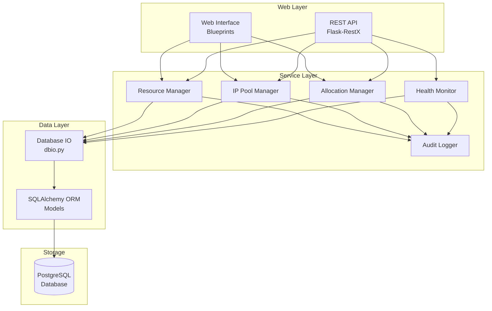
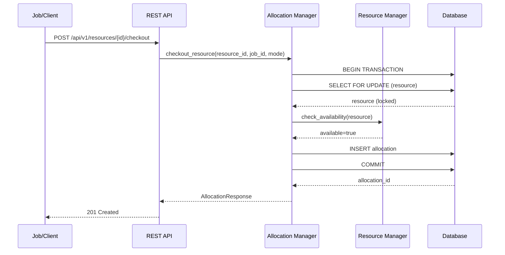

# Design Document: Resource Management

## Overview

The Resource Management module provides capabilities for tracking, allocating, and deconflicting usage of shared resources within the Pychestrate orchestration system. This design follows the existing Flask/Flask-RestX patterns in the codebase, using SQLAlchemy for data persistence and the established dbio pattern for database operations.

The module consists of four primary components:
1. **Resource Manager** - Handles resource CRUD, pool management, and metadata
2. **IP Pool Manager** - Handles IP address pools with CIDR ranges and IP allocation
3. **Allocation Manager** - Handles checkout, checkin, reservations, and concurrency
4. **Health Monitor** - Tracks resource health status and performs health checks

## Existing Implementation

The following components from the system-configuration module will be leveraged:

### Core Package (`source/packages/automojo/pychestrate/core/`)
- **orm.py**: Contains base models, User, Role, Permission models
- **managers/**: UserManager, SecurityManager, AuditLogger for authentication and logging
- **dbconnection.py**: PostgreSQL connection factory
- **dbio.py**: Database helper functions

### Web Service (`source/site/automojo/pychestrate/webservice/`)
- **restapi/versions/v1/config/**: REST API patterns and authentication decorators
- **webinterface/blueprints/config/**: Web interface patterns with Vue.js/Bootstrap

## Architecture



### Checkout Flow



## Components and Interfaces

### Resource Manager

The Resource Manager handles resource definitions, pools, tags, and metadata.

```python
from typing import Optional, List, Dict, Any
from dataclasses import dataclass, field
from datetime import datetime
from enum import Enum

class ResourceType(Enum):
    DEVICE = "device"
    IP_ADDRESS = "ip_address"
    PORT = "port"
    CREDENTIAL = "credential"
    GENERIC = "generic"

class HealthStatus(Enum):
    ONLINE = "online"
    OFFLINE = "offline"
    DEGRADED = "degraded"
    MAINTENANCE = "maintenance"

@dataclass
class ResourceCreateRequest:
    name: str
    resource_type: ResourceType
    pool_id: Optional[int] = None
    description: str = ""
    metadata: Dict[str, Any] = field(default_factory=dict)
    tags: List[str] = field(default_factory=list)
    capacity: int = 1  # For shared resources

@dataclass
class ResourceUpdateRequest:
    description: Optional[str] = None
    metadata: Optional[Dict[str, Any]] = None
    tags: Optional[List[str]] = None
    capacity: Optional[int] = None
    health_status: Optional[HealthStatus] = None

@dataclass
class ResourceResponse:
    id: int
    name: str
    resource_type: ResourceType
    pool_id: Optional[int]
    pool_name: Optional[str]
    description: str
    metadata: Dict[str, Any]
    tags: List[str]
    capacity: int
    current_allocations: int
    health_status: HealthStatus
    created_at: datetime
    updated_at: datetime

@dataclass
class ResourcePoolCreateRequest:
    name: str
    description: str = ""

@dataclass
class ResourcePoolResponse:
    id: int
    name: str
    description: str
    resource_count: int
    created_at: datetime
    created_by: str

class ResourceManager:
    def create_resource(self, request: ResourceCreateRequest, 
                        user_id: int) -> ResourceResponse:
        """Create a new resource."""
        pass
    
    def get_resource(self, resource_id: int) -> Optional[ResourceResponse]:
        """Get a resource by ID."""
        pass
    
    def get_resource_by_name(self, name: str, pool_id: int = None) -> Optional[ResourceResponse]:
        """Get a resource by name within a pool."""
        pass
    
    def update_resource(self, resource_id: int, request: ResourceUpdateRequest,
                        user_id: int) -> ResourceResponse:
        """Update resource information."""
        pass
    
    def delete_resource(self, resource_id: int, user_id: int) -> None:
        """Delete a resource. Fails if active allocations exist."""
        pass
    
    def list_resources(self, pool_id: int = None, resource_type: ResourceType = None,
                       tags: List[str] = None, health_status: HealthStatus = None,
                       available_only: bool = False, offset: int = 0, 
                       limit: int = 50) -> List[ResourceResponse]:
        """List resources with filtering and pagination."""
        pass
    
    def validate_resource_name(self, name: str) -> bool:
        """Validate resource name format."""
        pass
    
    # Pool Management
    def create_pool(self, request: ResourcePoolCreateRequest,
                    user_id: int) -> ResourcePoolResponse:
        """Create a new resource pool."""
        pass
    
    def get_pool(self, pool_id: int) -> Optional[ResourcePoolResponse]:
        """Get a pool by ID."""
        pass
    
    def list_pools(self, user_id: int, offset: int = 0,
                   limit: int = 50) -> List[ResourcePoolResponse]:
        """List pools the user has access to."""
        pass
    
    def delete_pool(self, pool_id: int, user_id: int) -> None:
        """Delete a pool. Fails if resources exist in pool."""
        pass
    
    def assign_resource_to_pool(self, resource_id: int, pool_id: int,
                                user_id: int) -> None:
        """Assign a resource to a pool."""
        pass
    
    # Tag Management
    def add_tags(self, resource_id: int, tags: List[str], user_id: int) -> None:
        """Add tags to a resource."""
        pass
    
    def remove_tags(self, resource_id: int, tags: List[str], user_id: int) -> None:
        """Remove tags from a resource."""
        pass
    
    def validate_tag_name(self, tag: str) -> bool:
        """Validate tag name format."""
        pass
    
    # Metadata Management
    def update_metadata(self, resource_id: int, metadata: Dict[str, Any],
                        user_id: int) -> None:
        """Update resource metadata."""
        pass
    
    def get_metadata(self, resource_id: int, include_sensitive: bool = False) -> Dict[str, Any]:
        """Get resource metadata, optionally including sensitive fields."""
        pass
```

### IP Pool Manager

The IP Pool Manager handles IP address pools with CIDR ranges and dynamic IP allocation.

```python
from typing import Optional, List, Tuple
from dataclasses import dataclass, field
from datetime import datetime
from ipaddress import IPv4Network, IPv6Network, IPv4Address, IPv6Address
from enum import Enum

class IPVersion(Enum):
    IPV4 = "ipv4"
    IPV6 = "ipv6"

@dataclass
class IPPoolCreateRequest:
    name: str
    cidr: str  # e.g., "192.168.1.0/24" or "2001:db8::/32"
    gateway: Optional[str] = None
    dns_servers: List[str] = field(default_factory=list)
    description: str = ""
    reserved_ips: List[str] = field(default_factory=list)  # IPs to exclude from allocation

@dataclass
class IPPoolUpdateRequest:
    description: Optional[str] = None
    gateway: Optional[str] = None
    dns_servers: Optional[List[str]] = None
    reserved_ips: Optional[List[str]] = None

@dataclass
class IPPoolResponse:
    id: int
    name: str
    cidr: str
    ip_version: IPVersion
    gateway: Optional[str]
    dns_servers: List[str]
    description: str
    total_addresses: int
    reserved_count: int
    allocated_count: int
    available_count: int
    created_at: datetime
    created_by: str

@dataclass
class IPAllocationRequest:
    pool_id: int
    count: int = 1  # Number of IPs to allocate
    specific_ip: Optional[str] = None  # Request a specific IP
    prefer_contiguous: bool = True  # Try to allocate contiguous block
    job_id: Optional[str] = None
    timeout_minutes: Optional[int] = None
    reason: str = ""

@dataclass
class IPAllocationResponse:
    id: int
    pool_id: int
    pool_name: str
    ip_address: str
    subnet_mask: str
    gateway: Optional[str]
    dns_servers: List[str]
    user_id: int
    username: str
    job_id: Optional[str]
    status: str  # active, released, expired
    checkout_time: datetime
    expected_checkin: Optional[datetime]

@dataclass
class IPBulkAllocationResponse:
    allocations: List[IPAllocationResponse]
    contiguous: bool
    start_ip: str
    end_ip: str

class IPPoolManager:
    def create_pool(self, request: IPPoolCreateRequest, 
                    user_id: int) -> IPPoolResponse:
        """Create a new IP address pool from CIDR range."""
        pass
    
    def get_pool(self, pool_id: int) -> Optional[IPPoolResponse]:
        """Get IP pool by ID."""
        pass
    
    def get_pool_by_name(self, name: str) -> Optional[IPPoolResponse]:
        """Get IP pool by name."""
        pass
    
    def update_pool(self, pool_id: int, request: IPPoolUpdateRequest,
                    user_id: int) -> IPPoolResponse:
        """Update IP pool settings."""
        pass
    
    def delete_pool(self, pool_id: int, user_id: int) -> None:
        """Delete IP pool. Fails if allocations exist."""
        pass
    
    def list_pools(self, user_id: int, offset: int = 0,
                   limit: int = 50) -> List[IPPoolResponse]:
        """List IP pools the user has access to."""
        pass
    
    def validate_cidr(self, cidr: str) -> Tuple[bool, Optional[str]]:
        """Validate CIDR notation. Returns (valid, error_message)."""
        pass
    
    def check_cidr_overlap(self, cidr: str, exclude_pool_id: int = None) -> List[IPPoolResponse]:
        """Check if CIDR overlaps with existing pools."""
        pass
    
    # IP Allocation
    def checkout_ip(self, request: IPAllocationRequest,
                    user_id: int) -> IPAllocationResponse:
        """Checkout a single IP address from pool."""
        pass
    
    def checkout_ips(self, request: IPAllocationRequest,
                     user_id: int) -> IPBulkAllocationResponse:
        """Checkout multiple IP addresses from pool."""
        pass
    
    def checkin_ip(self, allocation_id: int, user_id: int) -> None:
        """Release a single IP allocation."""
        pass
    
    def checkin_ips(self, allocation_ids: List[int], user_id: int) -> int:
        """Release multiple IP allocations. Returns count released."""
        pass
    
    def checkin_job_ips(self, job_id: str, user_id: int) -> int:
        """Release all IPs allocated to a job. Returns count released."""
        pass
    
    def get_allocation(self, allocation_id: int) -> Optional[IPAllocationResponse]:
        """Get IP allocation details."""
        pass
    
    def list_allocations(self, pool_id: int = None, user_id: int = None,
                         job_id: str = None, status: str = None,
                         offset: int = 0, limit: int = 50) -> List[IPAllocationResponse]:
        """List IP allocations with filtering."""
        pass
    
    def get_available_ips(self, pool_id: int, count: int = 10) -> List[str]:
        """Get list of available IPs in pool (for preview)."""
        pass
    
    def is_ip_available(self, pool_id: int, ip_address: str) -> bool:
        """Check if specific IP is available in pool."""
        pass
    
    def mark_ip_reserved(self, pool_id: int, ip_address: str, 
                         reason: str, user_id: int) -> None:
        """Mark an IP as reserved (excluded from allocation)."""
        pass
    
    def unmark_ip_reserved(self, pool_id: int, ip_address: str,
                           user_id: int) -> None:
        """Remove reserved status from an IP."""
        pass
    
    # Utilities
    def calculate_pool_stats(self, pool_id: int) -> dict:
        """Calculate pool statistics (total, reserved, allocated, available)."""
        pass
    
    def find_contiguous_block(self, pool_id: int, count: int) -> Optional[Tuple[str, str]]:
        """Find a contiguous block of available IPs. Returns (start_ip, end_ip) or None."""
        pass
    
    def expire_timed_out_allocations(self) -> int:
        """Release IP allocations that have exceeded timeout. Returns count expired."""
        pass
```

### Allocation Manager

The Allocation Manager handles checkout, checkin, reservations, and concurrency control.

```python
from typing import Optional, List
from dataclasses import dataclass
from datetime import datetime, timedelta
from enum import Enum

class AllocationMode(Enum):
    EXCLUSIVE = "exclusive"
    SHARED = "shared"

class AllocationStatus(Enum):
    ACTIVE = "active"
    RELEASED = "released"
    EXPIRED = "expired"
    FORCED = "forced"

@dataclass
class CheckoutRequest:
    resource_id: Optional[int] = None
    resource_name: Optional[str] = None
    pool_id: Optional[int] = None
    tags: Optional[List[str]] = None  # For tag-based checkout
    job_id: Optional[str] = None
    mode: AllocationMode = AllocationMode.EXCLUSIVE
    timeout_minutes: Optional[int] = None
    reason: str = ""

@dataclass
class AllocationResponse:
    id: int
    resource_id: int
    resource_name: str
    resource_type: str
    user_id: int
    username: str
    job_id: Optional[str]
    mode: AllocationMode
    status: AllocationStatus
    checkout_time: datetime
    expected_checkin: Optional[datetime]
    actual_checkin: Optional[datetime]
    duration_minutes: Optional[int]
    metadata: dict  # Resource metadata at checkout time

@dataclass
class ReservationRequest:
    resource_id: int
    job_id: Optional[str] = None
    start_time: datetime = None
    end_time: datetime = None
    mode: AllocationMode = AllocationMode.EXCLUSIVE
    reason: str = ""

@dataclass
class ReservationResponse:
    id: int
    resource_id: int
    resource_name: str
    user_id: int
    username: str
    job_id: Optional[str]
    start_time: datetime
    end_time: datetime
    mode: AllocationMode
    status: str  # pending, active, completed, cancelled
    created_at: datetime

class AllocationManager:
    def checkout(self, request: CheckoutRequest, user_id: int) -> AllocationResponse:
        """Checkout a resource. Uses database locking for concurrency."""
        pass
    
    def checkin(self, allocation_id: int, user_id: int) -> AllocationResponse:
        """Checkin a resource, releasing the allocation."""
        pass
    
    def force_checkin(self, allocation_id: int, admin_user_id: int,
                      reason: str) -> AllocationResponse:
        """Force checkin by administrator."""
        pass
    
    def get_allocation(self, allocation_id: int) -> Optional[AllocationResponse]:
        """Get allocation details."""
        pass
    
    def list_allocations(self, resource_id: int = None, user_id: int = None,
                         job_id: str = None, status: AllocationStatus = None,
                         offset: int = 0, limit: int = 50) -> List[AllocationResponse]:
        """List allocations with filtering."""
        pass
    
    def get_active_allocations(self, resource_id: int) -> List[AllocationResponse]:
        """Get all active allocations for a resource."""
        pass
    
    def check_availability(self, resource_id: int, mode: AllocationMode) -> bool:
        """Check if resource is available for allocation."""
        pass
    
    def find_available_resource(self, pool_id: int = None, tags: List[str] = None,
                                resource_type: str = None,
                                mode: AllocationMode = AllocationMode.EXCLUSIVE) -> Optional[int]:
        """Find an available resource matching criteria."""
        pass
    
    # Reservations
    def create_reservation(self, request: ReservationRequest,
                           user_id: int) -> ReservationResponse:
        """Create a future reservation."""
        pass
    
    def cancel_reservation(self, reservation_id: int, user_id: int) -> None:
        """Cancel a pending reservation."""
        pass
    
    def modify_reservation(self, reservation_id: int, start_time: datetime = None,
                           end_time: datetime = None, user_id: int = None) -> ReservationResponse:
        """Modify reservation time window."""
        pass
    
    def list_reservations(self, resource_id: int = None, user_id: int = None,
                          start_after: datetime = None, end_before: datetime = None,
                          offset: int = 0, limit: int = 50) -> List[ReservationResponse]:
        """List reservations with filtering."""
        pass
    
    def check_reservation_conflicts(self, resource_id: int, start_time: datetime,
                                    end_time: datetime, exclude_id: int = None) -> List[ReservationResponse]:
        """Check for conflicting reservations."""
        pass
    
    def activate_due_reservations(self) -> int:
        """Convert due reservations to active allocations. Returns count activated."""
        pass
    
    # Timeout handling
    def expire_timed_out_allocations(self) -> int:
        """Release allocations that have exceeded their timeout. Returns count expired."""
        pass
    
    # History and metrics
    def get_allocation_history(self, resource_id: int = None, user_id: int = None,
                               start_date: datetime = None, end_date: datetime = None,
                               offset: int = 0, limit: int = 50) -> List[AllocationResponse]:
        """Get historical allocations."""
        pass
    
    def get_utilization_metrics(self, resource_id: int = None, pool_id: int = None,
                                start_date: datetime = None, 
                                end_date: datetime = None) -> dict:
        """Calculate utilization metrics."""
        pass
    
    def export_allocation_data(self, resource_id: int = None, start_date: datetime = None,
                               end_date: datetime = None, format: str = "json") -> str:
        """Export allocation data in specified format."""
        pass
```

### Health Monitor

The Health Monitor tracks resource health and performs automated health checks.

```python
from typing import Optional, List, Callable
from dataclasses import dataclass
from datetime import datetime

@dataclass
class HealthCheckConfig:
    resource_id: int
    probe_url: Optional[str] = None
    probe_command: Optional[str] = None
    interval_seconds: int = 60
    timeout_seconds: int = 10
    failure_threshold: int = 3
    success_threshold: int = 1
    enabled: bool = True

@dataclass
class HealthTransition:
    id: int
    resource_id: int
    resource_name: str
    old_status: str
    new_status: str
    reason: str
    timestamp: datetime
    triggered_by: str  # "user", "health_check", "system"

class HealthMonitor:
    def update_health_status(self, resource_id: int, status: HealthStatus,
                             reason: str, user_id: int = None) -> None:
        """Update resource health status."""
        pass
    
    def get_health_history(self, resource_id: int, offset: int = 0,
                           limit: int = 50) -> List[HealthTransition]:
        """Get health status transition history."""
        pass
    
    def configure_health_check(self, config: HealthCheckConfig,
                               user_id: int) -> None:
        """Configure automated health check for a resource."""
        pass
    
    def get_health_check_config(self, resource_id: int) -> Optional[HealthCheckConfig]:
        """Get health check configuration."""
        pass
    
    def run_health_check(self, resource_id: int) -> bool:
        """Run health check and update status. Returns True if healthy."""
        pass
    
    def run_all_health_checks(self) -> dict:
        """Run all configured health checks. Returns summary."""
        pass
    
    def notify_allocation_holders(self, resource_id: int, message: str) -> int:
        """Notify users with active allocations. Returns count notified."""
        pass
```

## Data Models

### SQLAlchemy ORM Models

```python
from datetime import datetime
from sqlalchemy import Column, Integer, String, Boolean, DateTime, Text, ForeignKey, Table, Index, Enum as SQLEnum
from sqlalchemy.orm import relationship
from sqlalchemy.dialects.postgresql import JSONB

from automojo.pychestrate.core.orm import PychestrateModelBase

# Association table for resource-tag many-to-many
resource_tags = Table(
    'resource_tags',
    PychestrateModelBase.metadata,
    Column('resource_id', Integer, ForeignKey('resources.id'), primary_key=True),
    Column('tag_id', Integer, ForeignKey('tags.id'), primary_key=True)
)

# Association table for pool-role permissions
pool_permissions = Table(
    'pool_permissions',
    PychestrateModelBase.metadata,
    Column('pool_id', Integer, ForeignKey('resource_pools.id'), primary_key=True),
    Column('role_id', Integer, ForeignKey('system_roles.id'), primary_key=True),
    Column('can_view', Boolean, default=True, nullable=False),
    Column('can_checkout', Boolean, default=False, nullable=False),
    Column('can_manage', Boolean, default=False, nullable=False)
)

class ResourcePool(PychestrateModelBase):
    __tablename__ = 'resource_pools'
    
    id = Column(Integer, primary_key=True)
    name = Column(String(128), unique=True, nullable=False, index=True)
    description = Column(String(512))
    is_default = Column(Boolean, default=False, nullable=False)
    created_at = Column(DateTime, default=datetime.utcnow, nullable=False)
    created_by_id = Column(Integer, ForeignKey('pychestrate_users.id'))
    
    resources = relationship('Resource', back_populates='pool')

class IPPool(PychestrateModelBase):
    __tablename__ = 'ip_pools'
    
    id = Column(Integer, primary_key=True)
    name = Column(String(128), unique=True, nullable=False, index=True)
    cidr = Column(String(64), nullable=False)  # e.g., "192.168.1.0/24"
    ip_version = Column(String(8), nullable=False)  # ipv4, ipv6
    network_address = Column(String(64), nullable=False)  # Calculated from CIDR
    broadcast_address = Column(String(64))  # Calculated from CIDR (IPv4 only)
    subnet_mask = Column(String(64), nullable=False)  # e.g., "255.255.255.0"
    gateway = Column(String(64))
    dns_servers = Column(JSONB, default=[])
    description = Column(String(512))
    reserved_ips = Column(JSONB, default=[])  # List of IPs excluded from allocation
    created_at = Column(DateTime, default=datetime.utcnow, nullable=False)
    created_by_id = Column(Integer, ForeignKey('pychestrate_users.id'))
    
    allocations = relationship('IPAllocation', back_populates='pool')

class IPAllocation(PychestrateModelBase):
    __tablename__ = 'ip_allocations'
    
    id = Column(Integer, primary_key=True)
    pool_id = Column(Integer, ForeignKey('ip_pools.id'), nullable=False)
    ip_address = Column(String(64), nullable=False)
    user_id = Column(Integer, ForeignKey('pychestrate_users.id'), nullable=False)
    job_id = Column(String(128), index=True)
    status = Column(String(16), default='active', nullable=False)  # active, released, expired
    checkout_time = Column(DateTime, default=datetime.utcnow, nullable=False)
    expected_checkin = Column(DateTime)
    actual_checkin = Column(DateTime)
    reason = Column(String(512))
    
    pool = relationship('IPPool', back_populates='allocations')
    
    __table_args__ = (
        Index('ix_ip_allocations_pool_ip', 'pool_id', 'ip_address'),
        Index('ix_ip_allocations_pool_status', 'pool_id', 'status'),
        Index('ix_ip_allocations_job', 'job_id'),
    )

class Tag(PychestrateModelBase):
    __tablename__ = 'tags'
    
    id = Column(Integer, primary_key=True)
    name = Column(String(64), unique=True, nullable=False, index=True)
    description = Column(String(255))
    created_at = Column(DateTime, default=datetime.utcnow, nullable=False)
    
    resources = relationship('Resource', secondary=resource_tags, back_populates='tags')

class Resource(PychestrateModelBase):
    __tablename__ = 'resources'
    
    id = Column(Integer, primary_key=True)
    name = Column(String(128), nullable=False, index=True)
    resource_type = Column(String(32), nullable=False)  # device, ip_address, port, credential, generic
    pool_id = Column(Integer, ForeignKey('resource_pools.id'))
    description = Column(String(512))
    metadata_json = Column(JSONB, default={})
    sensitive_fields = Column(JSONB, default=[])  # List of metadata keys that are sensitive
    capacity = Column(Integer, default=1, nullable=False)
    health_status = Column(String(32), default='online', nullable=False)
    created_at = Column(DateTime, default=datetime.utcnow, nullable=False)
    updated_at = Column(DateTime, default=datetime.utcnow, onupdate=datetime.utcnow, nullable=False)
    created_by_id = Column(Integer, ForeignKey('pychestrate_users.id'))
    
    pool = relationship('ResourcePool', back_populates='resources')
    tags = relationship('Tag', secondary=resource_tags, back_populates='resources')
    allocations = relationship('Allocation', back_populates='resource')
    reservations = relationship('Reservation', back_populates='resource')
    health_checks = relationship('HealthCheckConfig', back_populates='resource', uselist=False)
    
    __table_args__ = (
        Index('ix_resources_pool_name', 'pool_id', 'name', unique=True),
    )

class Allocation(PychestrateModelBase):
    __tablename__ = 'allocations'
    
    id = Column(Integer, primary_key=True)
    resource_id = Column(Integer, ForeignKey('resources.id'), nullable=False)
    user_id = Column(Integer, ForeignKey('pychestrate_users.id'), nullable=False)
    job_id = Column(String(128), index=True)
    mode = Column(String(16), default='exclusive', nullable=False)  # exclusive, shared
    status = Column(String(16), default='active', nullable=False)  # active, released, expired, forced
    checkout_time = Column(DateTime, default=datetime.utcnow, nullable=False)
    expected_checkin = Column(DateTime)
    actual_checkin = Column(DateTime)
    duration_minutes = Column(Integer)
    reason = Column(String(512))
    forced_by_id = Column(Integer, ForeignKey('pychestrate_users.id'))
    force_reason = Column(String(512))
    metadata_snapshot = Column(JSONB, default={})  # Resource metadata at checkout time
    
    resource = relationship('Resource', back_populates='allocations')
    
    __table_args__ = (
        Index('ix_allocations_resource_status', 'resource_id', 'status'),
        Index('ix_allocations_user_status', 'user_id', 'status'),
    )

class Reservation(PychestrateModelBase):
    __tablename__ = 'reservations'
    
    id = Column(Integer, primary_key=True)
    resource_id = Column(Integer, ForeignKey('resources.id'), nullable=False)
    user_id = Column(Integer, ForeignKey('pychestrate_users.id'), nullable=False)
    job_id = Column(String(128), index=True)
    start_time = Column(DateTime, nullable=False)
    end_time = Column(DateTime, nullable=False)
    mode = Column(String(16), default='exclusive', nullable=False)
    status = Column(String(16), default='pending', nullable=False)  # pending, active, completed, cancelled
    reason = Column(String(512))
    created_at = Column(DateTime, default=datetime.utcnow, nullable=False)
    allocation_id = Column(Integer, ForeignKey('allocations.id'))  # Link when converted to allocation
    
    resource = relationship('Resource', back_populates='reservations')
    
    __table_args__ = (
        Index('ix_reservations_resource_time', 'resource_id', 'start_time', 'end_time'),
    )

class HealthTransitionLog(PychestrateModelBase):
    __tablename__ = 'health_transition_logs'
    
    id = Column(Integer, primary_key=True)
    resource_id = Column(Integer, ForeignKey('resources.id'), nullable=False)
    old_status = Column(String(32), nullable=False)
    new_status = Column(String(32), nullable=False)
    reason = Column(String(512))
    triggered_by = Column(String(32), nullable=False)  # user, health_check, system
    user_id = Column(Integer, ForeignKey('pychestrate_users.id'))
    timestamp = Column(DateTime, default=datetime.utcnow, nullable=False)

class HealthCheckConfigModel(PychestrateModelBase):
    __tablename__ = 'health_check_configs'
    
    id = Column(Integer, primary_key=True)
    resource_id = Column(Integer, ForeignKey('resources.id'), unique=True, nullable=False)
    probe_url = Column(String(512))
    probe_command = Column(String(1024))
    interval_seconds = Column(Integer, default=60, nullable=False)
    timeout_seconds = Column(Integer, default=10, nullable=False)
    failure_threshold = Column(Integer, default=3, nullable=False)
    success_threshold = Column(Integer, default=1, nullable=False)
    consecutive_failures = Column(Integer, default=0, nullable=False)
    consecutive_successes = Column(Integer, default=0, nullable=False)
    last_check_time = Column(DateTime)
    last_check_result = Column(Boolean)
    enabled = Column(Boolean, default=True, nullable=False)
    
    resource = relationship('Resource', back_populates='health_checks')

class ResourceMetadataHistory(PychestrateModelBase):
    __tablename__ = 'resource_metadata_history'
    
    id = Column(Integer, primary_key=True)
    resource_id = Column(Integer, ForeignKey('resources.id'), nullable=False)
    old_metadata_json = Column(JSONB)
    new_metadata_json = Column(JSONB)
    changed_by_id = Column(Integer, ForeignKey('pychestrate_users.id'))
    changed_at = Column(DateTime, default=datetime.utcnow, nullable=False)
```

### Entity Relationship Diagram

```mermaid
erDiagram
    ResourcePool ||--o{ Resource : contains
    Resource ||--o{ Allocation : has
    Resource ||--o{ Reservation : has
    Resource }o--o{ Tag : has
    Resource ||--o| HealthCheckConfigModel : has
    Resource ||--o{ HealthTransitionLog : has
    Resource ||--o{ ResourceMetadataHistory : has
    Role }o--o{ ResourcePool : "has permissions on"
    IPPool ||--o{ IPAllocation : contains
    
    ResourcePool {
        int id PK
        string name UK
        string description
        bool is_default
        datetime created_at
        int created_by_id FK
    }
    
    IPPool {
        int id PK
        string name UK
        string cidr
        string ip_version
        string network_address
        string broadcast_address
        string subnet_mask
        string gateway
        jsonb dns_servers
        jsonb reserved_ips
        datetime created_at
    }
    
    IPAllocation {
        int id PK
        int pool_id FK
        string ip_address
        int user_id FK
        string job_id
        string status
        datetime checkout_time
        datetime expected_checkin
    }
    
    Resource {
        int id PK
        string name
        string resource_type
        int pool_id FK
        string description
        jsonb metadata_json
        jsonb sensitive_fields
        int capacity
        string health_status
        datetime created_at
        datetime updated_at
    }
    
    Tag {
        int id PK
        string name UK
        string description
    }
    
    Allocation {
        int id PK
        int resource_id FK
        int user_id FK
        string job_id
        string mode
        string status
        datetime checkout_time
        datetime expected_checkin
        datetime actual_checkin
        int duration_minutes
        jsonb metadata_snapshot
    }
    
    Reservation {
        int id PK
        int resource_id FK
        int user_id FK
        string job_id
        datetime start_time
        datetime end_time
        string mode
        string status
        int allocation_id FK
    }
    
    HealthCheckConfigModel {
        int id PK
        int resource_id FK UK
        string probe_url
        string probe_command
        int interval_seconds
        int timeout_seconds
        int failure_threshold
        bool enabled
    }
    
    HealthTransitionLog {
        int id PK
        int resource_id FK
        string old_status
        string new_status
        string reason
        string triggered_by
        datetime timestamp
    }
```


## Correctness Properties

*A property is a characteristic or behavior that should hold true across all valid executions of a system—essentially, a formal statement about what the system should do. Properties serve as the bridge between human-readable specifications and machine-verifiable correctness guarantees.*

### Property 1: Resource Name Uniqueness

*For any* resource pool and any two resources within that pool, if both resources have the same name, then the second creation attempt should be rejected with an appropriate error.

**Validates: Requirements 1.2**

### Property 2: Resource Name Validation

*For any* string, the resource name validation should accept strings containing only alphanumeric characters, underscores, hyphens, and periods, and reject all other strings.

**Validates: Requirements 1.7**

### Property 3: Resource Deletion Constraint

*For any* resource with active allocations, attempting to delete that resource should be rejected. For any resource without active allocations, deletion should succeed.

**Validates: Requirements 1.4**

### Property 4: Pool Deletion Constraint

*For any* resource pool containing resources, attempting to delete that pool should be rejected. For any empty pool, deletion should succeed.

**Validates: Requirements 2.5**

### Property 5: Checkout-Checkin Round-Trip

*For any* available resource and valid checkout request, checking out the resource and then checking it back in should return the resource to available status with the same capacity as before.

**Validates: Requirements 3.1, 4.1**

### Property 6: Exclusive Allocation Enforcement

*For any* resource with an active exclusive allocation, subsequent checkout requests for that resource should be rejected and return the current allocation details.

**Validates: Requirements 3.2**

### Property 7: Shared Capacity Enforcement

*For any* shared resource with capacity N, exactly N concurrent shared allocations should be allowed. The (N+1)th checkout request should be rejected.

**Validates: Requirements 3.5**

### Property 8: Allocation Timeout Expiration

*For any* allocation created with a timeout, after the timeout period expires, the allocation should be automatically released and the resource should become available.

**Validates: Requirements 3.6**

### Property 9: Checkin Ownership Validation

*For any* allocation, only the user who created the allocation (or an administrator using force checkin) should be able to check in that allocation. Checkin attempts by other users should be rejected.

**Validates: Requirements 4.2**

### Property 10: Reservation Conflict Detection

*For any* two reservations on the same resource, if their time windows overlap, the second reservation should be rejected with conflict details. Non-overlapping reservations should both be accepted.

**Validates: Requirements 5.1, 5.2**

### Property 11: Reservation Activation

*For any* pending reservation whose start time has arrived, the reservation should be automatically converted to an active allocation with the same parameters.

**Validates: Requirements 5.3**

### Property 12: Health Status Allocation Blocking

*For any* resource with health status 'offline' or 'maintenance', checkout requests should be rejected. Resources with status 'online' or 'degraded' should allow checkouts.

**Validates: Requirements 6.3**

### Property 13: Tag-Based Resource Selection

*For any* tag-based checkout request, the selected resource should have all the requested tags and be available for allocation. If multiple resources match, selection should be deterministic.

**Validates: Requirements 7.3, 7.4**

### Property 14: Metadata Sensitive Field Masking

*For any* resource with sensitive metadata fields, non-privileged API responses should mask those field values. Privileged responses should include the actual values.

**Validates: Requirements 8.5**

### Property 15: Concurrent Checkout Serialization

*For any* resource and N simultaneous checkout requests, exactly one request should succeed and (N-1) should be rejected, regardless of timing.

**Validates: Requirements 12.1**

### Property 16: API Authentication Enforcement

*For any* API endpoint (except login), requests without valid bearer tokens should be rejected with 401 status.

**Validates: Requirements 10.2**

### Property 17: API Pagination Correctness

*For any* list endpoint with offset O and limit L, the response should contain at most L items starting from position O in the full result set.

**Validates: Requirements 10.4**

### Property 18: API Error Format Consistency

*For any* API error response, the response body should contain error_code, message, and details fields in a consistent JSON structure.

**Validates: Requirements 10.3**

### Property 19: CIDR Validation

*For any* string, the CIDR validation should accept valid IPv4 and IPv6 CIDR notation (e.g., "192.168.1.0/24", "2001:db8::/32") and reject invalid formats.

**Validates: Requirements 2A.2**

### Property 20: IP Pool Address Calculation

*For any* valid CIDR range, the calculated available addresses should equal the total host addresses minus network address, broadcast address (for IPv4), and reserved addresses.

**Validates: Requirements 2A.3**

### Property 21: IP Checkout-Checkin Round-Trip

*For any* IP pool with available addresses, checking out an IP and then checking it back in should return that IP to the available pool.

**Validates: Requirements 3A.1, 4A.1**

### Property 22: IP Pool Exhaustion

*For any* IP pool, when all available addresses are allocated, subsequent checkout requests should be rejected with a pool-exhausted error.

**Validates: Requirements 3A.6**

### Property 23: Specific IP Allocation

*For any* available IP address in a pool, requesting that specific IP should allocate exactly that address. Requesting an already-allocated IP should be rejected.

**Validates: Requirements 3A.3**

### Property 24: CIDR Overlap Detection

*For any* two CIDR ranges that overlap, creating the second IP pool should be rejected. Non-overlapping ranges should both be accepted.

**Validates: Requirements 2A.6**

### Property 25: Job IP Bulk Checkin

*For any* job with N allocated IP addresses, bulk checkin by job ID should release exactly N addresses and return them to available status.

**Validates: Requirements 4A.3**

## Error Handling

### Resource Manager Errors

| Error Code | HTTP Status | Description |
|------------|-------------|-------------|
| RESOURCE_NOT_FOUND | 404 | Resource with specified ID does not exist |
| RESOURCE_NAME_EXISTS | 409 | Resource with same name already exists in pool |
| RESOURCE_HAS_ALLOCATIONS | 409 | Cannot delete resource with active allocations |
| INVALID_RESOURCE_NAME | 400 | Resource name contains invalid characters |
| INVALID_RESOURCE_TYPE | 400 | Resource type is not supported |
| POOL_NOT_FOUND | 404 | Pool with specified ID does not exist |
| POOL_HAS_RESOURCES | 409 | Cannot delete pool containing resources |
| INVALID_TAG_NAME | 400 | Tag name contains invalid characters |

### Allocation Manager Errors

| Error Code | HTTP Status | Description |
|------------|-------------|-------------|
| RESOURCE_UNAVAILABLE | 409 | Resource is not available for checkout |
| RESOURCE_OFFLINE | 409 | Resource is offline or in maintenance |
| CAPACITY_EXCEEDED | 409 | Shared resource has reached capacity limit |
| ALLOCATION_NOT_FOUND | 404 | Allocation with specified ID does not exist |
| NOT_ALLOCATION_OWNER | 403 | User is not the owner of this allocation |
| RESERVATION_CONFLICT | 409 | Reservation conflicts with existing reservation |
| RESERVATION_NOT_FOUND | 404 | Reservation with specified ID does not exist |
| INVALID_TIME_WINDOW | 400 | Reservation time window is invalid |
| CHECKOUT_PERMISSION_DENIED | 403 | User lacks checkout permission for pool |
| LOCK_TIMEOUT | 503 | Could not acquire lock, retry later |
| CONCURRENT_MODIFICATION | 409 | Resource was modified by another request |

### IP Pool Manager Errors

| Error Code | HTTP Status | Description |
|------------|-------------|-------------|
| IP_POOL_NOT_FOUND | 404 | IP pool with specified ID does not exist |
| INVALID_CIDR | 400 | CIDR notation is invalid |
| CIDR_OVERLAP | 409 | CIDR range overlaps with existing pool |
| IP_POOL_HAS_ALLOCATIONS | 409 | Cannot delete pool with active allocations |
| IP_POOL_EXHAUSTED | 409 | No available IP addresses in pool |
| IP_NOT_AVAILABLE | 409 | Requested IP address is not available |
| IP_NOT_IN_POOL | 400 | Requested IP address is not in pool range |
| IP_ALLOCATION_NOT_FOUND | 404 | IP allocation with specified ID does not exist |
| NOT_IP_ALLOCATION_OWNER | 403 | User is not the owner of this IP allocation |
| IP_RESERVED | 409 | IP address is marked as reserved |

## Testing Strategy

### Property-Based Testing

Property-based tests will be implemented using Hypothesis to validate the correctness properties defined above. Each property test will:
- Generate random valid inputs
- Execute the operation under test
- Verify the property holds for all generated inputs
- Run minimum 100 iterations per property

### Unit Testing

Unit tests will cover:
- Specific examples demonstrating correct behavior
- Edge cases (empty pools, zero capacity, boundary times)
- Error conditions and exception handling
- Integration points between components

### Test Configuration

- Property tests: Minimum 100 iterations per test
- Test database: In-memory SQLite for unit tests, PostgreSQL for integration tests
- Concurrency tests: Use threading to simulate simultaneous requests
- Tag format: **Feature: resources, Property {number}: {property_text}**

