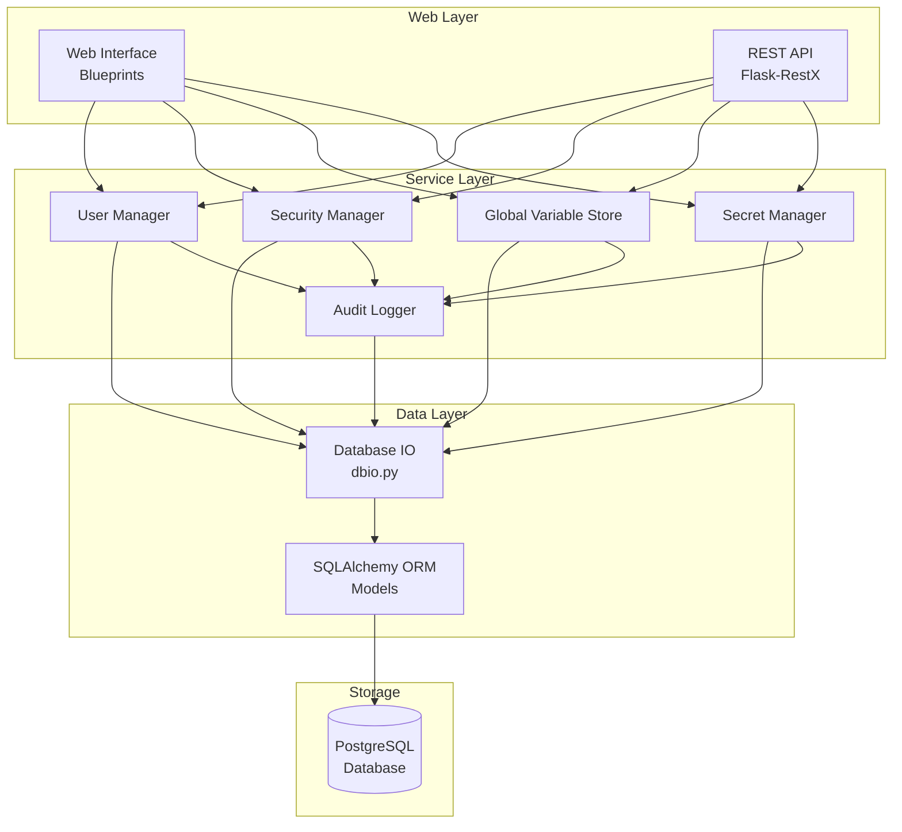
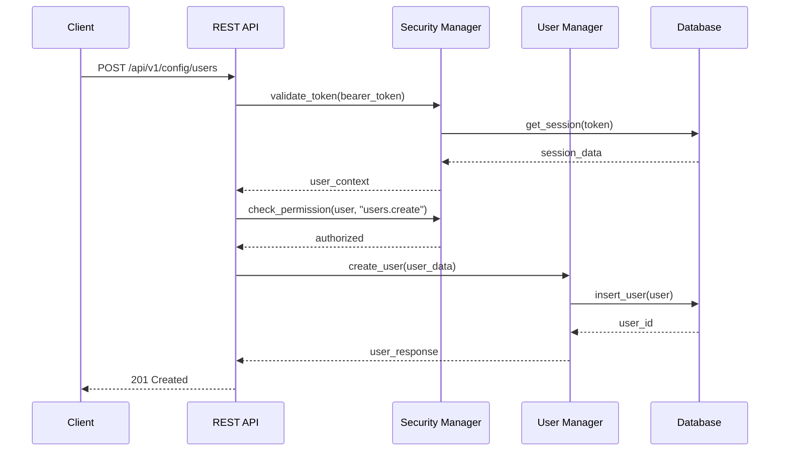
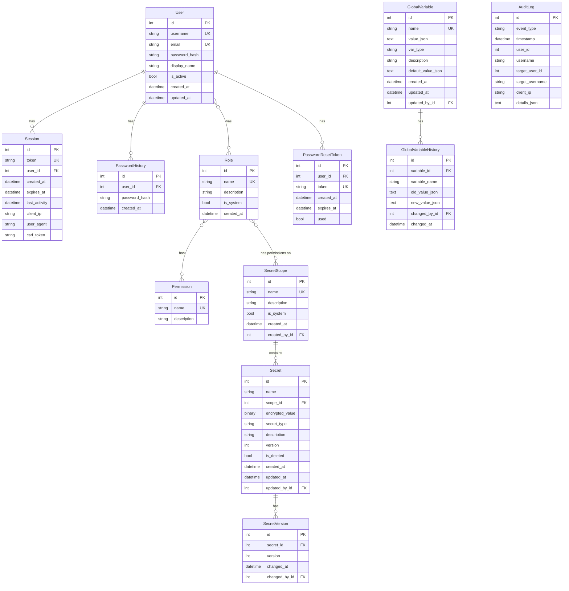

# Design Document: System Configuration

## Overview

The System Configuration module provides foundational user management, security, and global configuration capabilities for the Pychestrate orchestration system. This design follows the existing Flask/Flask-RestX patterns in the codebase, using SQLAlchemy for data persistence and the established dbio pattern for database operations.

The module consists of four primary components:
1. **User Manager** - Handles user CRUD, role assignment, and permission management
2. **Security Manager** - Handles authentication, session management, and access control
3. **Global Variable Store** - Manages system-wide configuration variables
4. **Secret Manager** - Handles secure storage and retrieval of sensitive credentials

## Existing Implementation

The following components already exist and will be leveraged:

### Core Package (`source/packages/automojo/pychestrate/core/`)
- **orm.py**: Contains `PychestrateModelBase`, `SerializableModel` mixin, and existing `User` model (OAuth-based with provider, status, roles as comma-separated string)
- **dbconnection.py**: `DatabaseConnectionFactory` with `BasicSocketDatabaseConnectionFactory` and `BasicTcpDatabaseConnectionFactory` for PostgreSQL
- **dbio.py**: Helper functions `database_exists()`, `database_create()`, `create_network_attached_database()`, `open_network_attached_database()`
- **defaults.py**: Utility functions `utc_now()`, `new_uuid()`, `reset_token_expiration()`

### Web Service (`source/site/automojo/pychestrate/webservice/`)
- **security.py**: `csrf_token_generate()`, `csrf_token_validate()`, `send_password_reset_email()`
- **metadata.py**: `SITE_SHARED_GLOBALS` with DATABASE_ENGINE, DATABASE_SESSION_FACTORY, SMTP config
- **dbio.py**: `get_database_session()` helper
- **restapi/versions/v1/__init__.py**: Flask-RestX API setup with namespace pattern

### Web Interface (`source/site/automojo/pychestrate/webservice/webinterface/`)
- **blueprints/public/home.html**: Vue.js/Bootstrap template pattern
- **static/**: JavaScript libraries (Vue, Bootstrap-Vue, bcrypt.js, etc.)

### Base Framework (`automojo-webservice-flask` package in .venv)
The `automojo.webservice.xflask` module provides extensive base infrastructure:

#### ORM Models (`baseorm.py`)
- **User**: OAuth-based user with provider, provider_ref_id, roles (comma-separated), status, usertype
- **Credential**: Password hash storage for local authentication (linked via provider_ref_id)
- **CredentialResetToken**: Password reset tokens with expiration
- **Organization**: Multi-tenant organization support
- **Membership**: User-organization associations with roles
- **Role**: Organization-scoped roles
- **UserGroup**: Organization-scoped groups
- **OAuthToken**: OAuth access/refresh token storage per user/provider

#### Security (`basesecurity.py`)
- **RouteSecurityManager**: Role-based route access control with public/secure endpoint registration
- **get_csrf_token()**: Session-based CSRF token generation
- **validate_csrf_token()**: CSRF token validation

#### Authentication (`baseauthentication.py`)
- **check_authentication_with_roles()**: Request authentication and authorization enforcement
- **OauthProviderNames**: Supported OAuth providers enum

#### Endpoints (`baseendpoints.py`)
- **endpoint_authorize()**: OAuth callback handler
- **endpoint_login_oauth()**: OAuth login initiation
- **endpoint_login_password()**: Local password authentication
- **endpoint_logout()**: Session termination with token revocation
- **endpoint_register_local()**: Local user registration with captcha
- **endpoint_register_oauth()**: OAuth registration flow
- **endpoint_request_password_reset()**: Password reset request
- **endpoint_reset_password()**: Password reset completion

#### Operations (`baseoperations.py`)
- **create_user_from_local()**: Create user with credential record
- **create_user_from_oauth()**: Create user from OAuth profile
- **create_credential_reset_token()**: Generate password reset token
- **validate_reset_token_for_user()**: Validate reset token
- **lookup_user_by_username()**, **lookup_user_by_email()**, **lookup_user_by_provider_ref_id()**: User lookups
- **lookup_user_credential()**: Get credential for user
- **upsert_oauth_token_for_user()**: Store/update OAuth tokens
- **mark_oauth_token_revoked()**: Revoke OAuth tokens
- **refresh_oauth_access_token_for_user()**: Refresh OAuth access tokens
- **send_password_reset_email()**: Send reset email via SMTP

#### Blueprint (`securityblueprint.py`)
- **SecurityBlueprint**: Flask Blueprint with integrated route security
- **@public_route()**: Decorator for public endpoints
- **@secure_route()**: Decorator for authenticated endpoints with optional roles

#### State Management (`basestate.py`)
- **BASE_SITE_SERVICE_STATE**: Shared service state (database, OAuth, credentials, etc.)
- **initialize_service_state()**: Service initialization
- **initialize_flask_application()**: Flask app configuration
- **establish_session()**: Create authenticated session

## Architecture




### Request Flow



## Components and Interfaces

### User Manager

The User Manager handles all user-related operations including CRUD, role assignment, and permission calculation.

```python
from typing import Optional, List
from dataclasses import dataclass
from datetime import datetime

@dataclass
class UserCreateRequest:
    username: str
    email: str
    password: str
    display_name: str
    role_ids: List[int] = None

@dataclass
class UserUpdateRequest:
    email: Optional[str] = None
    display_name: Optional[str] = None
    is_active: Optional[bool] = None
    role_ids: Optional[List[int]] = None

@dataclass
class UserResponse:
    id: int
    username: str
    email: str
    display_name: str
    is_active: bool
    roles: List[str]
    created_at: datetime
    updated_at: datetime

class UserManager:
    def create_user(self, request: UserCreateRequest) -> UserResponse:
        """Create a new user account."""
        pass
    
    def get_user(self, user_id: int) -> Optional[UserResponse]:
        """Retrieve a user by ID."""
        pass
    
    def get_user_by_username(self, username: str) -> Optional[UserResponse]:
        """Retrieve a user by username."""
        pass
    
    def update_user(self, user_id: int, request: UserUpdateRequest) -> UserResponse:
        """Update user information."""
        pass
    
    def deactivate_user(self, user_id: int) -> None:
        """Deactivate a user account and invalidate sessions."""
        pass
    
    def list_users(self, offset: int = 0, limit: int = 50, 
                   search: str = None, is_active: bool = None) -> List[UserResponse]:
        """List users with pagination and filtering."""
        pass
    
    def assign_role(self, user_id: int, role_id: int) -> None:
        """Assign a role to a user."""
        pass
    
    def remove_role(self, user_id: int, role_id: int) -> None:
        """Remove a role from a user."""
        pass
    
    def get_effective_permissions(self, user_id: int) -> List[str]:
        """Calculate effective permissions from all assigned roles."""
        pass
```

### Security Manager

The Security Manager handles authentication, session management, and access control.

```python
from typing import Optional, List
from dataclasses import dataclass
from datetime import datetime

@dataclass
class AuthRequest:
    username: str
    password: str
    client_ip: str
    user_agent: str

@dataclass
class AuthResponse:
    token: str
    expires_at: datetime
    user_id: int
    username: str

@dataclass
class SessionInfo:
    session_id: str
    user_id: int
    username: str
    created_at: datetime
    last_activity: datetime
    client_ip: str
    user_agent: str

@dataclass
class PasswordResetRequest:
    username: str
    email: str

class SecurityManager:
    def authenticate(self, request: AuthRequest) -> AuthResponse:
        """Authenticate user and create session."""
        pass
    
    def validate_token(self, token: str) -> Optional[SessionInfo]:
        """Validate bearer token and return session info."""
        pass
    
    def logout(self, token: str) -> None:
        """Invalidate the current session."""
        pass
    
    def logout_all(self, user_id: int, except_token: str = None) -> int:
        """Invalidate all sessions for a user, optionally keeping one."""
        pass
    
    def check_permission(self, user_id: int, permission: str) -> bool:
        """Check if user has a specific permission."""
        pass
    
    def request_password_reset(self, request: PasswordResetRequest) -> None:
        """Generate and send password reset token."""
        pass
    
    def reset_password(self, username: str, token: str, new_password: str) -> None:
        """Reset password using valid reset token."""
        pass
    
    def validate_password_strength(self, password: str) -> List[str]:
        """Validate password meets security requirements. Returns list of violations."""
        pass
    
    def generate_csrf_token(self, session_id: str) -> str:
        """Generate CSRF token for session."""
        pass
    
    def validate_csrf_token(self, session_id: str, token: str) -> bool:
        """Validate CSRF token for session."""
        pass
    
    def list_active_sessions(self, user_id: int = None) -> List[SessionInfo]:
        """List active sessions, optionally filtered by user."""
        pass
    
    def terminate_session(self, session_id: str) -> None:
        """Terminate a specific session."""
        pass
    
    def cleanup_expired_sessions(self) -> int:
        """Remove expired sessions. Returns count removed."""
        pass
```

### Global Variable Store

The Global Variable Store manages system-wide configuration variables with type validation.

```python
from typing import Optional, List, Any, Union
from dataclasses import dataclass
from datetime import datetime
from enum import Enum

class VariableType(Enum):
    STRING = "string"
    INTEGER = "integer"
    FLOAT = "float"
    BOOLEAN = "boolean"
    JSON = "json"

@dataclass
class GlobalVariableCreateRequest:
    name: str
    value: Any
    var_type: VariableType
    description: str = ""
    default_value: Any = None

@dataclass
class GlobalVariableUpdateRequest:
    value: Any
    description: Optional[str] = None

@dataclass
class GlobalVariableResponse:
    id: int
    name: str
    value: Any
    var_type: VariableType
    description: str
    default_value: Any
    created_at: datetime
    updated_at: datetime
    updated_by: str

@dataclass
class VariableChangeLog:
    id: int
    variable_name: str
    old_value: Any
    new_value: Any
    changed_by: str
    changed_at: datetime

class GlobalVariableStore:
    def create_variable(self, request: GlobalVariableCreateRequest, 
                        user_id: int) -> GlobalVariableResponse:
        """Create a new global variable."""
        pass
    
    def get_variable(self, name: str) -> Optional[GlobalVariableResponse]:
        """Get a variable by name."""
        pass
    
    def get_value(self, name: str, default: Any = None) -> Any:
        """Get variable value, returning default if not set."""
        pass
    
    def update_variable(self, name: str, request: GlobalVariableUpdateRequest,
                        user_id: int) -> GlobalVariableResponse:
        """Update a variable's value."""
        pass
    
    def delete_variable(self, name: str, user_id: int) -> None:
        """Delete a variable."""
        pass
    
    def list_variables(self, offset: int = 0, limit: int = 50,
                       search: str = None) -> List[GlobalVariableResponse]:
        """List variables with pagination."""
        pass
    
    def get_change_history(self, name: str, offset: int = 0, 
                           limit: int = 50) -> List[VariableChangeLog]:
        """Get change history for a variable."""
        pass
    
    def validate_value(self, value: Any, var_type: VariableType) -> bool:
        """Validate value matches expected type."""
        pass
    
    def serialize_value(self, value: Any, var_type: VariableType) -> str:
        """Serialize value to JSON string for storage."""
        pass
    
    def deserialize_value(self, json_str: str, var_type: VariableType) -> Any:
        """Deserialize JSON string to typed value."""
        pass
```

### Audit Logger

The Audit Logger records security-relevant events for compliance and investigation.

```python
from typing import Optional, List, Any
from dataclasses import dataclass
from datetime import datetime
from enum import Enum

class AuditEventType(Enum):
    AUTH_SUCCESS = "auth_success"
    AUTH_FAILURE = "auth_failure"
    LOGOUT = "logout"
    USER_CREATED = "user_created"
    USER_UPDATED = "user_updated"
    USER_DEACTIVATED = "user_deactivated"
    ROLE_ASSIGNED = "role_assigned"
    ROLE_REMOVED = "role_removed"
    PASSWORD_CHANGED = "password_changed"
    PASSWORD_RESET_REQUESTED = "password_reset_requested"
    PASSWORD_RESET_COMPLETED = "password_reset_completed"
    VARIABLE_CREATED = "variable_created"
    VARIABLE_UPDATED = "variable_updated"
    VARIABLE_DELETED = "variable_deleted"
    SESSION_TERMINATED = "session_terminated"
    SECRET_CREATED = "secret_created"
    SECRET_UPDATED = "secret_updated"
    SECRET_DELETED = "secret_deleted"
    SECRET_ACCESSED = "secret_accessed"
    SCOPE_CREATED = "scope_created"
    SCOPE_DELETED = "scope_deleted"

@dataclass
class AuditLogEntry:
    id: int
    event_type: AuditEventType
    timestamp: datetime
    user_id: Optional[int]
    username: Optional[str]
    target_user_id: Optional[int]
    target_username: Optional[str]
    client_ip: Optional[str]
    details: dict

@dataclass
class AuditLogQuery:
    event_types: List[AuditEventType] = None
    user_id: int = None
    target_user_id: int = None
    start_date: datetime = None
    end_date: datetime = None
    offset: int = 0
    limit: int = 50

class AuditLogger:
    def log_event(self, event_type: AuditEventType, user_id: int = None,
                  username: str = None, target_user_id: int = None,
                  target_username: str = None, client_ip: str = None,
                  details: dict = None) -> None:
        """Log an audit event."""
        pass
    
    def query_logs(self, query: AuditLogQuery) -> List[AuditLogEntry]:
        """Query audit logs with filters."""
        pass
    
    def cleanup_old_logs(self, retention_days: int = 90) -> int:
        """Remove logs older than retention period. Returns count removed."""
        pass
```

### Secret Manager

The Secret Manager handles secure storage and retrieval of sensitive credentials using AES-256 encryption.

```python
from typing import Optional, List
from dataclasses import dataclass
from datetime import datetime
from enum import Enum

class SecretType(Enum):
    PASSWORD = "password"
    API_KEY = "api_key"
    CERTIFICATE = "certificate"
    SSH_KEY = "ssh_key"
    GENERIC = "generic"

@dataclass
class SecretScopeCreateRequest:
    name: str
    description: str = ""

@dataclass
class SecretScopeResponse:
    id: int
    name: str
    description: str
    secret_count: int
    created_at: datetime
    created_by: str

@dataclass
class SecretCreateRequest:
    name: str
    value: str
    secret_type: SecretType
    scope_id: int
    description: str = ""

@dataclass
class SecretUpdateRequest:
    value: Optional[str] = None
    description: Optional[str] = None

@dataclass
class SecretMetadataResponse:
    """Response that never includes the actual secret value."""
    id: int
    name: str
    secret_type: SecretType
    scope_id: int
    scope_name: str
    description: str
    version: int
    created_at: datetime
    updated_at: datetime
    updated_by: str

@dataclass
class SecretValueResponse:
    """Response with decrypted value - only for authorized access."""
    name: str
    value: str
    secret_type: SecretType

class SecretManager:
    def __init__(self, encryption_key: bytes):
        """Initialize with AES-256 encryption key."""
        pass
    
    # Scope Management
    def create_scope(self, request: SecretScopeCreateRequest, 
                     user_id: int) -> SecretScopeResponse:
        """Create a new secret scope."""
        pass
    
    def get_scope(self, scope_id: int) -> Optional[SecretScopeResponse]:
        """Get scope by ID."""
        pass
    
    def get_scope_by_name(self, name: str) -> Optional[SecretScopeResponse]:
        """Get scope by name."""
        pass
    
    def list_scopes(self, user_id: int, offset: int = 0, 
                    limit: int = 50) -> List[SecretScopeResponse]:
        """List scopes the user has access to."""
        pass
    
    def delete_scope(self, scope_id: int, user_id: int) -> None:
        """Delete a scope. Fails if secrets exist in scope."""
        pass
    
    def grant_scope_permission(self, scope_id: int, role_id: int, 
                               can_read: bool, can_manage: bool) -> None:
        """Grant role permissions on a scope."""
        pass
    
    def revoke_scope_permission(self, scope_id: int, role_id: int) -> None:
        """Revoke role permissions on a scope."""
        pass
    
    # Secret Management
    def create_secret(self, request: SecretCreateRequest, 
                      user_id: int) -> SecretMetadataResponse:
        """Create a new secret with encrypted value."""
        pass
    
    def get_secret_metadata(self, name: str, scope_id: int) -> Optional[SecretMetadataResponse]:
        """Get secret metadata without the value."""
        pass
    
    def get_secret_value(self, name: str, scope_id: int, 
                         user_id: int) -> SecretValueResponse:
        """Get decrypted secret value. Requires read permission."""
        pass
    
    def resolve_secret_reference(self, reference: str, 
                                 user_id: int) -> str:
        """Resolve a secret reference (e.g., '${scope/secret_name}') to its value."""
        pass
    
    def update_secret(self, name: str, scope_id: int,
                      request: SecretUpdateRequest, 
                      user_id: int) -> SecretMetadataResponse:
        """Update secret value or metadata. Increments version."""
        pass
    
    def delete_secret(self, name: str, scope_id: int, user_id: int) -> None:
        """Mark secret as deleted."""
        pass
    
    def list_secrets(self, scope_id: int = None, user_id: int = None,
                     offset: int = 0, limit: int = 50) -> List[SecretMetadataResponse]:
        """List secrets (metadata only) filtered by scope and user permissions."""
        pass
    
    def check_scope_permission(self, user_id: int, scope_id: int, 
                               permission: str) -> bool:
        """Check if user has permission (read/manage) on scope."""
        pass
    
    # Encryption utilities
    def _encrypt_value(self, plaintext: str) -> bytes:
        """Encrypt a secret value using AES-256-GCM."""
        pass
    
    def _decrypt_value(self, ciphertext: bytes) -> str:
        """Decrypt a secret value."""
        pass
```

## Data Models

### SQLAlchemy ORM Models

```python
from datetime import datetime
from sqlalchemy import Column, Integer, String, Boolean, DateTime, Text, ForeignKey, Table, LargeBinary, Index
from sqlalchemy.orm import relationship
from sqlalchemy.ext.declarative import declarative_base

Base = declarative_base()

# Association table for user-role many-to-many
user_roles = Table(
    'user_roles',
    Base.metadata,
    Column('user_id', Integer, ForeignKey('users.id'), primary_key=True),
    Column('role_id', Integer, ForeignKey('roles.id'), primary_key=True)
)

# Association table for role-permission many-to-many
role_permissions = Table(
    'role_permissions',
    Base.metadata,
    Column('role_id', Integer, ForeignKey('roles.id'), primary_key=True),
    Column('permission_id', Integer, ForeignKey('permissions.id'), primary_key=True)
)

class User(Base):
    __tablename__ = 'users'
    
    id = Column(Integer, primary_key=True)
    username = Column(String(64), unique=True, nullable=False, index=True)
    email = Column(String(255), unique=True, nullable=False)
    password_hash = Column(String(255), nullable=False)
    display_name = Column(String(128), nullable=False)
    is_active = Column(Boolean, default=True, nullable=False)
    created_at = Column(DateTime, default=datetime.utcnow, nullable=False)
    updated_at = Column(DateTime, default=datetime.utcnow, onupdate=datetime.utcnow, nullable=False)
    
    roles = relationship('Role', secondary=user_roles, back_populates='users')
    sessions = relationship('Session', back_populates='user', cascade='all, delete-orphan')
    password_history = relationship('PasswordHistory', back_populates='user', cascade='all, delete-orphan')

class Role(Base):
    __tablename__ = 'roles'
    
    id = Column(Integer, primary_key=True)
    name = Column(String(64), unique=True, nullable=False)
    description = Column(String(255))
    is_system = Column(Boolean, default=False, nullable=False)  # System roles cannot be deleted
    created_at = Column(DateTime, default=datetime.utcnow, nullable=False)
    
    users = relationship('User', secondary=user_roles, back_populates='roles')
    permissions = relationship('Permission', secondary=role_permissions, back_populates='roles')

class Permission(Base):
    __tablename__ = 'permissions'
    
    id = Column(Integer, primary_key=True)
    name = Column(String(64), unique=True, nullable=False)  # e.g., "users.create", "users.read"
    description = Column(String(255))
    
    roles = relationship('Role', secondary=role_permissions, back_populates='permissions')

class Session(Base):
    __tablename__ = 'sessions'
    
    id = Column(Integer, primary_key=True)
    token = Column(String(64), unique=True, nullable=False, index=True)
    user_id = Column(Integer, ForeignKey('users.id'), nullable=False)
    created_at = Column(DateTime, default=datetime.utcnow, nullable=False)
    expires_at = Column(DateTime, nullable=False)
    last_activity = Column(DateTime, default=datetime.utcnow, nullable=False)
    client_ip = Column(String(45))  # IPv6 max length
    user_agent = Column(String(255))
    csrf_token = Column(String(64))
    
    user = relationship('User', back_populates='sessions')

class PasswordHistory(Base):
    __tablename__ = 'password_history'
    
    id = Column(Integer, primary_key=True)
    user_id = Column(Integer, ForeignKey('users.id'), nullable=False)
    password_hash = Column(String(255), nullable=False)
    created_at = Column(DateTime, default=datetime.utcnow, nullable=False)
    
    user = relationship('User', back_populates='password_history')

class PasswordResetToken(Base):
    __tablename__ = 'password_reset_tokens'
    
    id = Column(Integer, primary_key=True)
    user_id = Column(Integer, ForeignKey('users.id'), nullable=False)
    token = Column(String(64), unique=True, nullable=False, index=True)
    created_at = Column(DateTime, default=datetime.utcnow, nullable=False)
    expires_at = Column(DateTime, nullable=False)
    used = Column(Boolean, default=False, nullable=False)

class GlobalVariable(Base):
    __tablename__ = 'global_variables'
    
    id = Column(Integer, primary_key=True)
    name = Column(String(128), unique=True, nullable=False, index=True)
    value_json = Column(Text, nullable=False)  # JSON-encoded value
    var_type = Column(String(16), nullable=False)  # string, integer, float, boolean, json
    description = Column(String(512))
    default_value_json = Column(Text)  # JSON-encoded default
    created_at = Column(DateTime, default=datetime.utcnow, nullable=False)
    updated_at = Column(DateTime, default=datetime.utcnow, onupdate=datetime.utcnow, nullable=False)
    updated_by_id = Column(Integer, ForeignKey('users.id'))

class GlobalVariableHistory(Base):
    __tablename__ = 'global_variable_history'
    
    id = Column(Integer, primary_key=True)
    variable_id = Column(Integer, ForeignKey('global_variables.id'), nullable=False)
    variable_name = Column(String(128), nullable=False)  # Denormalized for history after deletion
    old_value_json = Column(Text)
    new_value_json = Column(Text)
    changed_by_id = Column(Integer, ForeignKey('users.id'))
    changed_at = Column(DateTime, default=datetime.utcnow, nullable=False)

class AuditLog(Base):
    __tablename__ = 'audit_logs'
    
    id = Column(Integer, primary_key=True)
    event_type = Column(String(64), nullable=False, index=True)
    timestamp = Column(DateTime, default=datetime.utcnow, nullable=False, index=True)
    user_id = Column(Integer)
    username = Column(String(64))
    target_user_id = Column(Integer)
    target_username = Column(String(64))
    client_ip = Column(String(45))
    details_json = Column(Text)  # JSON-encoded details

# Association table for scope-role permissions
scope_permissions = Table(
    'scope_permissions',
    Base.metadata,
    Column('scope_id', Integer, ForeignKey('secret_scopes.id'), primary_key=True),
    Column('role_id', Integer, ForeignKey('roles.id'), primary_key=True),
    Column('can_read', Boolean, default=False, nullable=False),
    Column('can_manage', Boolean, default=False, nullable=False)
)

class SecretScope(Base):
    __tablename__ = 'secret_scopes'
    
    id = Column(Integer, primary_key=True)
    name = Column(String(128), unique=True, nullable=False, index=True)
    description = Column(String(512))
    is_system = Column(Boolean, default=False, nullable=False)  # System scope for admin-only secrets
    created_at = Column(DateTime, default=datetime.utcnow, nullable=False)
    created_by_id = Column(Integer, ForeignKey('users.id'))
    
    secrets = relationship('Secret', back_populates='scope', cascade='all, delete-orphan')

class Secret(Base):
    __tablename__ = 'secrets'
    
    id = Column(Integer, primary_key=True)
    name = Column(String(128), nullable=False, index=True)
    scope_id = Column(Integer, ForeignKey('secret_scopes.id'), nullable=False)
    encrypted_value = Column(LargeBinary, nullable=False)  # AES-256-GCM encrypted
    secret_type = Column(String(32), nullable=False)  # password, api_key, certificate, ssh_key, generic
    description = Column(String(512))
    version = Column(Integer, default=1, nullable=False)
    is_deleted = Column(Boolean, default=False, nullable=False)
    created_at = Column(DateTime, default=datetime.utcnow, nullable=False)
    updated_at = Column(DateTime, default=datetime.utcnow, onupdate=datetime.utcnow, nullable=False)
    updated_by_id = Column(Integer, ForeignKey('users.id'))
    
    scope = relationship('SecretScope', back_populates='secrets')
    
    __table_args__ = (
        # Unique constraint on name within scope
        Index('ix_secrets_scope_name', 'scope_id', 'name', unique=True),
    )

class SecretVersion(Base):
    """Tracks version history without storing previous plain text values."""
    __tablename__ = 'secret_versions'
    
    id = Column(Integer, primary_key=True)
    secret_id = Column(Integer, ForeignKey('secrets.id'), nullable=False)
    version = Column(Integer, nullable=False)
    changed_at = Column(DateTime, default=datetime.utcnow, nullable=False)
    changed_by_id = Column(Integer, ForeignKey('users.id'))
```

### Entity Relationship Diagram




## Correctness Properties

*A property is a characteristic or behavior that should hold true across all valid executions of a system—essentially, a formal statement about what the system should do. Properties serve as the bridge between human-readable specifications and machine-verifiable correctness guarantees.*

### Property 1: User Creation Uniqueness

*For any* valid user creation request, if a user with the same username already exists, the creation SHALL be rejected; otherwise, the user SHALL be created with a unique identifier.

**Validates: Requirements 1.1, 1.2**

### Property 2: Username Validation

*For any* string provided as a username, the User_Manager SHALL accept it if and only if it contains only alphanumeric characters, underscores, and hyphens.

**Validates: Requirements 1.6**

### Property 3: Email Validation

*For any* string provided as an email, the User_Manager SHALL accept it if and only if it conforms to standard email format (contains @ with valid local and domain parts).

**Validates: Requirements 1.7**

### Property 4: User Deactivation Session Invalidation

*For any* user with active sessions, when the user is deactivated, all sessions for that user SHALL become invalid.

**Validates: Requirements 1.4**

### Property 5: Authentication Correctness

*For any* authentication attempt, the Security_Manager SHALL return a valid session token if and only if the provided username exists and the password matches the stored hash.

**Validates: Requirements 2.1, 2.2**

### Property 6: Session Logout Invalidation

*For any* valid session, after logout is called with that session's token, the token SHALL no longer be valid for authentication.

**Validates: Requirements 2.3**

### Property 7: Session Expiry Enforcement

*For any* session with an expiry time in the past, the Security_Manager SHALL reject authentication attempts using that session's token.

**Validates: Requirements 2.4**

### Property 8: Password Reset Token Lifecycle

*For any* password reset token, it SHALL be valid for password reset if and only if it has not expired and has not been used; after successful use, the token SHALL be invalidated.

**Validates: Requirements 2.5, 2.6, 2.7**

### Property 9: Password Strength Validation

*For any* password, the Security_Manager SHALL accept it if and only if it is at least 12 characters long AND contains at least one uppercase letter, one lowercase letter, one digit, and one special character.

**Validates: Requirements 3.1, 3.2**

### Property 10: Password Hash Storage

*For any* stored user password, the stored value SHALL NOT equal the plaintext password and SHALL be verifiable using bcrypt or argon2 verification.

**Validates: Requirements 3.3**

### Property 11: Password History Enforcement

*For any* password change attempt, if the new password matches any of the user's last 5 password hashes, the change SHALL be rejected.

**Validates: Requirements 3.4**

### Property 12: Password Change Session Invalidation

*For any* user with multiple active sessions, when the password is changed from one session, all other sessions for that user SHALL become invalid.

**Validates: Requirements 3.5**

### Property 13: Role Permission Propagation

*For any* user assigned to a role, the user's effective permissions SHALL include all permissions assigned to that role; when the role is removed, those permissions SHALL be removed from the user's effective permissions.

**Validates: Requirements 4.2, 4.3**

### Property 14: Permission Check Enforcement

*For any* action requiring a specific permission, the Security_Manager SHALL allow the action if and only if the user has that permission in their effective permissions.

**Validates: Requirements 4.4**

### Property 15: Role Permission Update Propagation

*For any* role with assigned users, when the role's permissions are modified, all users with that role SHALL have their effective permissions updated to reflect the change.

**Validates: Requirements 4.6**

### Property 16: Session Data Completeness

*For any* created session, it SHALL contain a valid user identifier, creation timestamp, last activity timestamp, and client information (IP and user agent).

**Validates: Requirements 5.1**

### Property 17: Session Inactivity Expiration

*For any* session with last activity time older than the configured inactivity timeout, the session SHALL be considered expired and rejected for authentication.

**Validates: Requirements 5.2**

### Property 18: Concurrent Session Limit

*For any* user, the number of active sessions SHALL NOT exceed the configured maximum; when the limit is reached, new session creation SHALL either fail or invalidate the oldest session.

**Validates: Requirements 5.5**

### Property 19: CSRF Token Uniqueness

*For any* two different sessions, their CSRF tokens SHALL be different.

**Validates: Requirements 6.1**

### Property 20: CSRF Token Validation

*For any* state-changing request, it SHALL be processed if and only if the provided CSRF token matches the session's current CSRF token.

**Validates: Requirements 6.2, 6.3**

### Property 21: Global Variable Type Validation

*For any* global variable, the stored value SHALL be valid for the declared variable type; updates with values that don't match the type SHALL be rejected.

**Validates: Requirements 7.2, 7.5**

### Property 22: Global Variable Serialization Round-Trip

*For any* global variable value and type, serializing to JSON and then deserializing SHALL produce a value equivalent to the original.

**Validates: Requirements 7.7, 7.8**

### Property 23: Global Variable Default Fallback

*For any* request for a non-existent global variable with a provided default, the Global_Variable_Store SHALL return the default value.

**Validates: Requirements 7.4**

### Property 24: Audit Log Completeness

*For any* authentication event, permission change, or variable modification, an audit log entry SHALL be created with timestamp, acting user, and relevant details.

**Validates: Requirements 8.1, 8.2, 8.3**

### Property 25: Audit Log Retention

*For any* audit log entry older than the configured retention period, the cleanup process SHALL remove it; entries within the retention period SHALL be preserved.

**Validates: Requirements 8.4**

### Property 26: API Authentication Enforcement

*For any* REST API endpoint except login, requests without a valid bearer token SHALL be rejected with 401 status.

**Validates: Requirements 9.2**

### Property 27: API Error Format Consistency

*For any* API error response, it SHALL contain error_code, message, and details fields in JSON format.

**Validates: Requirements 9.3**

### Property 28: API Pagination Correctness

*For any* list endpoint with offset and limit parameters, the response SHALL contain at most `limit` items starting from position `offset`.

**Validates: Requirements 9.4**

### Property 29: Secret Encryption Round-Trip

*For any* secret value, encrypting with AES-256 and then decrypting SHALL produce the original plaintext value; the encrypted value SHALL NOT equal the plaintext.

**Validates: Requirements 11.1, 11.2**

### Property 30: Secret Value Masking

*For any* API response containing secret metadata, the response SHALL NOT contain the plaintext secret value.

**Validates: Requirements 11.9**

### Property 31: Secret Scope Access Control

*For any* secret retrieval request, the Secret_Manager SHALL return the value if and only if the requesting user has read permission on the secret's scope.

**Validates: Requirements 11.7, 12.2**

### Property 32: Secret Reference Resolution

*For any* valid secret reference in the format `${scope/secret_name}`, the Secret_Manager SHALL resolve it to the decrypted secret value if the requester has permission.

**Validates: Requirements 11.10**

### Property 33: Scope Deletion Constraint

*For any* scope containing secrets, deletion of that scope SHALL be rejected; empty scopes SHALL be deletable.

**Validates: Requirements 12.4**

### Property 34: Secret Listing Permission Filter

*For any* secret listing request, the results SHALL contain only secrets from scopes where the requesting user has read permission.

**Validates: Requirements 12.5**

## Error Handling

### Error Response Format

All errors follow a consistent JSON format:

```python
@dataclass
class ErrorResponse:
    error_code: str      # Machine-readable error code (e.g., "USER_NOT_FOUND")
    message: str         # Human-readable error message
    details: dict = None # Additional context (e.g., validation errors)
```

### Error Categories

| Category | HTTP Status | Error Codes |
|----------|-------------|-------------|
| Authentication | 401 | `INVALID_CREDENTIALS`, `SESSION_EXPIRED`, `TOKEN_INVALID` |
| Authorization | 403 | `PERMISSION_DENIED`, `SCOPE_ACCESS_DENIED` |
| Validation | 400 | `INVALID_INPUT`, `DUPLICATE_USERNAME`, `WEAK_PASSWORD`, `INVALID_EMAIL` |
| Not Found | 404 | `USER_NOT_FOUND`, `ROLE_NOT_FOUND`, `VARIABLE_NOT_FOUND`, `SECRET_NOT_FOUND`, `SCOPE_NOT_FOUND` |
| Conflict | 409 | `USERNAME_EXISTS`, `SCOPE_NOT_EMPTY`, `PASSWORD_REUSED` |
| Server Error | 500 | `INTERNAL_ERROR`, `DATABASE_ERROR`, `ENCRYPTION_ERROR` |

### Exception Hierarchy

```python
class SystemConfigError(Exception):
    """Base exception for system configuration errors."""
    error_code: str
    http_status: int = 500

class AuthenticationError(SystemConfigError):
    http_status = 401

class AuthorizationError(SystemConfigError):
    http_status = 403

class ValidationError(SystemConfigError):
    http_status = 400

class NotFoundError(SystemConfigError):
    http_status = 404

class ConflictError(SystemConfigError):
    http_status = 409
```

## Testing Strategy

### Dual Testing Approach

This module uses both unit tests and property-based tests for comprehensive coverage:

- **Unit tests**: Verify specific examples, edge cases, and error conditions
- **Property tests**: Verify universal properties across randomly generated inputs

### Property-Based Testing Framework

The project uses **Hypothesis** for property-based testing in Python.

Configuration:
- Minimum 100 iterations per property test
- Each test tagged with feature and property reference

### Test Organization

```
source/testroots/testbase/
├── test_user_manager/
│   ├── test_user_crud.py           # Unit tests for user CRUD
│   ├── test_user_validation.py     # Unit tests for validation
│   └── test_user_properties.py     # Property tests for user operations
├── test_security_manager/
│   ├── test_authentication.py      # Unit tests for auth
│   ├── test_session.py             # Unit tests for sessions
│   ├── test_password.py            # Unit tests for password operations
│   └── test_security_properties.py # Property tests for security
├── test_global_variable_store/
│   ├── test_variable_crud.py       # Unit tests for variable CRUD
│   ├── test_variable_types.py      # Unit tests for type handling
│   └── test_variable_properties.py # Property tests for variables
├── test_secret_manager/
│   ├── test_secret_crud.py         # Unit tests for secret CRUD
│   ├── test_scope_management.py    # Unit tests for scopes
│   ├── test_encryption.py          # Unit tests for encryption
│   └── test_secret_properties.py   # Property tests for secrets
└── test_audit_logger/
    ├── test_logging.py             # Unit tests for audit logging
    └── test_audit_properties.py    # Property tests for audit
```

### Property Test Annotation Format

Each property test must be annotated with:

```python
from hypothesis import given, settings
import hypothesis.strategies as st

@settings(max_examples=100)
@given(username=st.text(min_size=1, max_size=64, alphabet=st.characters(whitelist_categories=('L', 'N'), whitelist_characters='_-')))
def test_username_validation_property(username):
    """
    Feature: system-configuration
    Property 2: Username Validation
    Validates: Requirements 1.6
    """
    # Test implementation
    pass
```

### Key Test Strategies

1. **User Validation**: Generate random strings and verify validation accepts only valid patterns
2. **Authentication**: Generate user/password combinations and verify correct accept/reject behavior
3. **Session Management**: Generate sessions with various timestamps and verify expiry logic
4. **Password Strength**: Generate passwords with various character compositions and verify validation
5. **Variable Serialization**: Generate values of each type and verify round-trip consistency
6. **Secret Encryption**: Generate secret values and verify encryption round-trip
7. **Permission Checking**: Generate user/role/permission combinations and verify access control
