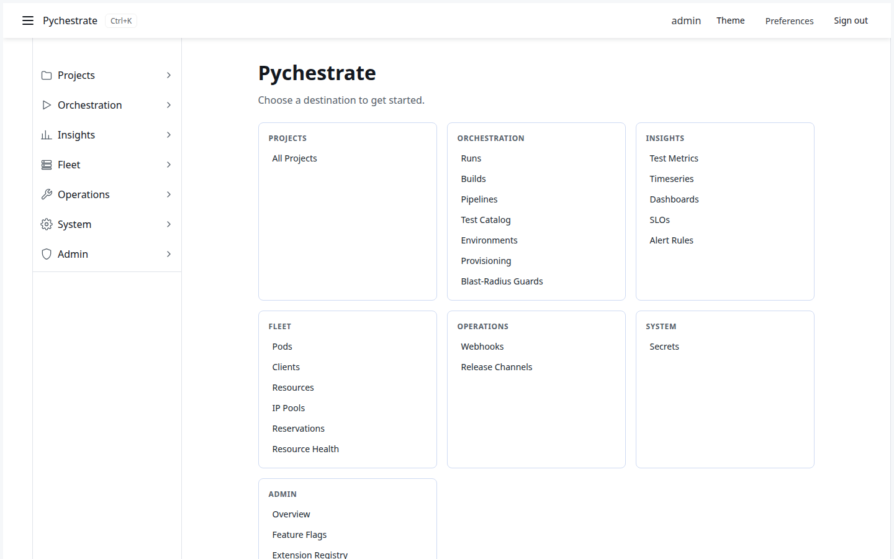

###########
Pychestrate
###########

Pychestrate is a self-hosted service for teams that build, test, and
operate software on real devices and infrastructure. It keeps an
inventory of the lab and records who is using which device, organizes
work into projects, and runs build, test, infrastructure, and robotic
process automation (RPA) jobs on *pods* -- the machines that do the
work -- collecting their progress, results, and artifacts.

This repository is the service: the web interface, the REST API under
``/api/v1``, and an MCP endpoint for AI agents. Pods run the
``pychestrate-client`` agent, which lives in its own repository.

         Orchestration, Insights, Fleet, Operations, System, and Admin,
         and the page lists every destination in them.

Status
======

**Developer preview.** The latest tag is ``v0.0.7-preview``
(2026-05-20); ``main`` carries the unreleased changes listed in
`CHANGELOG.md <CHANGELOG.md>`_. Pychestrate is usable for evaluation and
development, but it is not supported for production use beyond the
project author and direct collaborators. `ROADMAP.md <ROADMAP.md>`_
says what works, what does not, and what the milestones mean.

Try it
======

You need Linux or macOS, Python 3.12, Poetry 2, ``git``, ``make``,
``openssl``, and read access to the private Code Craft AI framework
packages (`how to get it
<userguide/02-00-getting-started.rst#get-access-to-the-dependencies>`_).
Then:

.. code-block:: bash

    git clone https://github.com/code-craft-ai-company/pychestrate-service.git
    cd pychestrate-service
    repository-setup/rehome-repository    # writes .env
    development/setup-environment         # creates .venv and installs the dependencies
    make dev-up                           # serves http://127.0.0.1:8888

Open ``http://127.0.0.1:8888/``. A new server sends you to its setup
wizard: paste the token from ``.cache/presence/initial-admin-token``,
create the first administrator, and sign in. `Getting Started
<userguide/02-00-getting-started.rst>`_ walks through it, and on to your
first project.

Run the tests
=============

The tests use the ``testbase`` framework, not pytest:

.. code-block:: bash

    source .venv/bin/activate
    testbase testing run --root source/testroots/ccai --includes=ccai.tests.singlehost --output=.output/singlehost
    testbase agents summary extract --summary-file .output/singlehost/testrun_summary.json

`CONTRIBUTING.md <CONTRIBUTING.md>`_ covers focused runs, the suites that
need a live server, and what a pull request needs.

Documentation
=============

* `User Manual <userguide/userguide.rst>`_ -- start with the
  `Overview <userguide/01-00-overview.rst>`_ and
  `Getting Started <userguide/02-00-getting-started.rst>`_.
* `Deploying Pychestrate <userguide/13-00-alpha-deployment.rst>`_ -- the
  operator runbook.
* `Extensions <userguide/11-00-extensions.rst>`_ -- the extension
  points and how to build an extension pack.
* `The pyc Command Line <userguide/14-00-pyc-command-line.rst>`_ --
  ``pyc``, the command line for the REST API, installable on its own
  (``pipx install ./packages/pychestrate-cli``).
* `REST API <specs/openapi/pychestrate.yaml>`_ -- the OpenAPI 3.1
  contract for ``/api/v1``. A running service renders it at ``/api/docs``.
* `CONTRIBUTING.md <CONTRIBUTING.md>`_, `CHANGELOG.md <CHANGELOG.md>`_,
  and `ROADMAP.md <ROADMAP.md>`_.

License
=======

Proprietary; licensed per organization for on-premises use. See
`LICENSE.txt <LICENSE.txt>`_.
